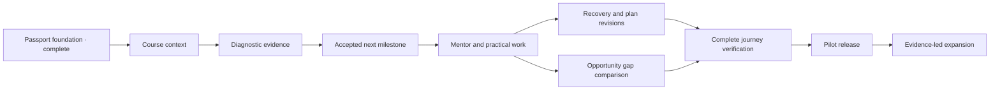

# Meno implementation plan

Updated on 14 October 2026. This is the working delivery roadmap for the complete Meno experience, from the committed foundation through a usable pilot and later expansion. Foundation commit: `97c2c9e`. Repository organization, bootstrap, and Slice 1 are implemented. Slice 2 has begun: **C1 course-context persistence and C2's manual course editor are complete. AI1 is merged through PR #4; D1 content/scoring is implemented on its feature branch.** C1 was merged through [PR #1](https://github.com/Ekene-Chris/meno/pull/1) with passing CI; C2 was merged through [PR #2](https://github.com/Ekene-Chris/meno/pull/2) with passing CI. Hosted development setup is recorded in [HOSTED_DEVELOPMENT.md](HOSTED_DEVELOPMENT.md). The full mentor demonstration is not yet complete. See the [root README](../README.md) for the current setup.

Build a persistent mentor that helps a returning learner take a useful next step and see why it matters. The first complete demonstration runs from existing course context to diagnostic evidence, accepted recovery work, evaluated submission, and a changed opportunity requirement gap.

There is no fixed deadline. Work in dependency order, finish each acceptance gate, and keep the returning-learner journey as the priority when choosing scope.

## What we are building

Meno connects **learner context → observable skill evidence → a useful next action → practical work → clearer opportunity gaps**. The Passport preserves that continuity. The Momentum Engine helps a learner move forward; the Opportunity Engine gives that work a credible destination. The interface should always explain the next action and why it fits this learner.

| Product area | What the learner can do when the core product is complete | Delivery stage |
|---|---|---|
| Account and Passport | Sign in, keep goals and preferences, inspect evidence and its source, return without losing context | Foundation exists; evidence view grows in Stages 3–4; account/data controls in Stage 7 |
| Existing learning | Describe a course or class, correct mapped topics, mark the current checkpoint, and continue from there | Stage 3 |
| Skill assessment | Take a short check, skip or retry, and understand strengths, uncertainty, and gaps | Stage 3 |
| Learning path | Accept, edit, or decline a manageable milestone linked to the current course and goal | Stage 3; revisions in Stage 4 |
| Mentor workspace | Ask a course-aware question, see a different explanation, and choose relevant practice or a vetted resource | Stage 4 |
| Practical work | Submit bounded work, see rubric-based feedback, and inspect exactly which evidence changed | Stage 4 |
| Recovery | Explain an obstacle, reduce a plan, or resume after a pause without losing previous evidence | Stage 4 |
| Opportunity Radar | Inspect requirements, sources, eligibility uncertainty, relevant evidence, and a useful gap-closing task | Stage 5 |
| Research and operations | Understand limitations, report a problem, control personal data, and use a reliable supported pilot | Research throughout; Stages 6–7 |

### Four journeys, one shared system

| Entry | Initial path | What must be preserved |
|---|---|---|
| Returning or stuck — primary | Existing course/checkpoint → selective diagnostic → short recovery milestone → supported task → changed opportunity gap | Retained strengths and prior progress; no automatic restart |
| Just starting | Goal → gentle prerequisite check → small first milestone → explanation and practice | Ability to skip, choose pace, and see why the first step matters |
| Actively learning | Current course/module → a stated question or obstacle → relevant help → optional check/task | Existing course order and current checkpoint |
| Seeking opportunities | Goal and self-reported/project context → requirements comparison → targeted evidence-building task | Existing evidence and freedom to explore; a project link alone is not verified skill |

The first working domain remains frontend JavaScript. Other domains are visible in the long-term scope, not silently claimed as supported by the first diagnostic.

### Release boundaries

- **Core prototype — Stages 0–6:** The entire returning-learner loop works with real persistence, a bounded live mentor integration, deterministic checks, learner-approved plans, and clearly labeled demo opportunities. The other entry states reuse this system. A model-unavailable fallback remains usable.
- **Pilot — Stage 7:** Selected real learners can use hosted authentication, recovery flows, data controls, verified content, monitored services, and a documented support process. This is a separate release gate, not implied by a successful local demo.
- **Expansion — Stage 8:** Broader subjects, languages, uploads, notifications, offline support, and partnerships follow observed learner needs and viable operating costs.

The existing strategy remains the product source of truth. This roadmap sequences its capabilities; it does not add employment guarantees, automated application decisions, or a new product direction.

## Scope and decision status

The [product strategy](PRODUCT_STRATEGY.md) defines the product, and the [technical design](TECHNICAL_DESIGN.md) supplies the proposed implementation. The [project review](PROJECT_REVIEW.md) distinguishes confirmed requirements from assumptions and records source inconsistencies.

Bootstrap adopted the recommended TypeScript modular monolith with Next.js, React, local Supabase, Tailwind, and Zod. Exact versions and the npm lockfile are now in the repository. Email/password authentication uses cookie sessions. These are implementation choices recorded in the technical design, not new founder-confirmed product decisions. Hosted development now uses Vercel/Supabase, and AI1 adds configurable OpenAI extraction; see the current feature status and hosted guide.

Initial defaults proposed for implementation are a frontend JavaScript curriculum, pasted course outlines, a small vetted resource set, labeled fictional opportunities, English text with stored locale preference, and in-app check-ins. Upload processing, arbitrary web fetching, automated reminders, broad job feeds, and full offline operation are deferred.

## Delivery sequence

| Stage | Dependency | Deliverable | Exit gate |
|---|---|---|---|
| 0. Repository organization | None | Canonical handoff paths, preserved sources, review and plan | Complete; initial source checksums passed. Temporary guides are now consolidated in the root README. |
| 1. Application bootstrap | Stage 0 | Runnable application and reproducible development setup | Complete; clean install, lint, typecheck, unit tests, setup helper, and production build pass. |
| 2. Slice 1: Passport foundation | Stage 1 | Authentication, goals, constraints, private persisted learner context | Implemented; session reentry, atomic saves, cross-user denial, and evidence restrictions pass database/browser tests. |
| 3. Slice 2: Course, diagnostic, recovery | Stage 2 | Editable syllabus mapping, real assessment evidence, proposed/accepted milestone | In progress: C1/C2/AI1 are merged; D1/D2 are merged; P1 adds next-step selection and stored proposals on its feature branch. Learner review/acceptance remains P2. Full gate: different results yield different justified next steps. |
| 4. Slice 3: Mentor and Momentum | Stage 3 | Contextual help, practical task, approved recovery revision | Evaluated work changes relevant evidence and the next action. |
| 5. Slice 4: Opportunity Radar | Stage 4; requirements fixture can start in Stage 3 | Transparent skill gaps connected to learning | New evidence changes only the opportunity requirements it supports. |
| 6. Slice 5: Demo and resilience | Stages 2–5 | Reproducible full journey, alternative entries, mobile/error validation | David's story completes without manual database changes between steps. |
| 7. Pilot readiness | Stage 6 plus hosting, content, and operating decisions | Hosted access, account recovery, data controls, verified content, monitoring, learner feedback | Pilot release gate below passes; real learner access is intentionally enabled. |
| 8. Expansion | Pilot findings and measured operating needs | Prioritized broader capabilities | Each addition solves an observed need and has its own acceptance gate. |

Resource curation and a fictional opportunity requirements fixture can be prepared alongside assessment design. Build the product in the order above; this does not require multiple agents or independent services.

### Stage 0 — Repository organization

Completed: restored root instructions, strategy/design documents, diagrams, original Word reference, navigation, and editor/ignore settings. Bootstrap populated the agreed application, database, and test folders and consolidated their temporary guides into the root README. The Word strategy, product strategy, and eight diagrams remain unchanged; implementation decisions are appended explicitly to the technical design. Next.js added its generated framework-guidance block to `AGENTS.md`.

### Stage 1 — Application bootstrap

**Status:** Implemented. The following checklist documents the scope delivered; it is not a request to scaffold the app again.

1. Verify supported runtime and framework versions using official documentation. Select one package manager, pin the chosen toolchain, and commit its lockfile when changes are ready for version control.
2. Record stack adoption, local/hosted development database choice, and authentication entry flow in the technical decision log. A local Supabase workflow depends on a working Docker service; check this before assuming it is available. Prefer a simple tester-friendly auth flow without adding social providers.
3. Scaffold Next.js App Router with TypeScript and Tailwind under `src/app/`, with shared UI under `src/components/`. Establish layout, navigation, loading, empty, and error states only for implemented routes.
4. Add validated environment configuration and `.env.example` with placeholders. Separate browser-safe configuration from server-only keys. Keep model selection configurable and report missing integration configuration honestly.
5. Establish `lib/auth/` and `lib/db/` boundaries, shared error responses, and small request/response schemas. Add the AI adapter only when its first feature needs it.
6. Configure lint, typecheck, Vitest, and Playwright commands. Add a lightweight CI workflow using the same commands and a reproducible database test setup when migrations arrive.
7. Replace the README's pre-implementation setup note with commands actually verified on this repository, including clean install, local environment, database setup, development, and test execution.

**Verification:** Start from the lockfile, run the application locally, and pass the initial checks/build. No screen should claim that onboarding, mentorship, or assessment works before it has a working implementation.

### Stage 2 — Slice 1: Secure Learner Passport

**Status:** Implemented and verified locally. Subsequent work should extend these boundaries rather than replace the persistent foundation.

**Directories:** `src/features/learner-passport/`, `src/lib/auth/`, `src/lib/db/`, `src/app/onboarding/`, `src/app/dashboard/`, needed auth/API routes, `supabase/migrations/`, and the three test layers as needed.

1. Implement sign-in, sign-out, session handling, and protected reads/writes. Resolve identity on the server from authenticated context.
2. Create the minimum schema: profiles with entry state and optional learning constraints; learning goals with one active goal per learner; shared skills and prerequisite edges; learner skill state and evidence foundations; bounded learning events.
3. Define evidence provenance and status rules before any route can change assessed skill state. Derive `demonstrated` only from a scoped rubric or checkable assessment result. Keep self-report and AI inference distinguishable.
4. Add grants and RLS with the migrations. Permit appropriate profile/goal edits while restricting assessed evidence and derived status to trusted services. Shared taxonomy is readable but not learner-writable.
5. Seed 10–20 provisional frontend skill IDs and an acyclic prerequisite graph. Leave unassessed learner skills unknown; do not create achievements from onboarding confidence.
6. Build four entry choices, saved goal/preferences, and a dashboard showing the current context and honest next action. Keep optional constraints optional.
7. Document stored data and a scoped way to erase local demo learner data. Keep real personal data out of fixtures and logs.

**Acceptance:** A learner signs in, saves a goal, refreshes, signs out/in, and sees the same Passport. A second user and an anonymous client cannot read or modify it. Client-supplied user IDs cannot change ownership. A learner cannot directly promote their own skill to `demonstrated`.

**Tests:** Actual database authorization for select/insert/update/delete; protected route behavior; onboarding validation; active-goal constraint and retry behavior; session persistence. Auth/RLS failures must block progression to the next slice.

### Stage 3 — Slice 2: Course context, assessment, and first recovery plan

**Status:** C1/C2 are complete; AI1 and D1 are merged through PRs #4/#5. D2 is merged through PR #6. P1 adds evidence- and constraint-based recovery proposals on `feat/recovery-proposals`; P2 will add learner review and acceptance. The [course-context contract](COURSE_CONTEXT.md) records the manual flow; the [diagnostic contract](DIAGNOSTIC.md) records attempts, deterministic evaluation, evidence precedence and limitations.

**Directories:** `features/resources/`, `features/assessment/`, `features/learning-paths/`, `app/assessment/`, `app/learning-path/`, the necessary API routes, and the first `lib/ai/` schemas/provider adapter.

1. Add courses/modules, assessments/attempts, learning paths/milestones, and their ownership constraints. Persist a learner's current course checkpoint. Version question sets and rubrics; retain the version used by each attempt.
2. Accept a course title, source type, optional reference URL, and bounded pasted outline. Treat text as untrusted data. A URL is a reference in this slice, not an instruction to fetch restricted content.
3. Extract candidate topics into a validated draft mapped only to existing skill IDs. Show uncertainty, permit corrections, and require confirmation before committing the course mapping. Provide manual topic entry when the provider is unavailable.
4. Implement a short diagnostic for functions, arrays, promises, and relevant prerequisites. Include skip/retake behavior; skipped skills remain `not_assessed`.
5. Score bounded objective items deterministically. Persist answers, scoped findings, evidence references, rubric version, and limitations. An incomplete answer must not silently become a failed skill or a passed task.
6. Use evidence and available study time to propose a short recovery milestone. Validate model suggestions against known skills/resources; select a conservative deterministic next step if generation fails. Save a consequential plan change only after learner confirmation.
7. Align David's fixture explicitly: API integration remains unassessed until observed; promises needs review only when a recorded result supports it. Follow the reconciliation noted in the project review before finalizing fixture data.
8. Define one fictional frontend opportunity's required skill IDs now as a test fixture, so the practical task will later affect a specific requirement.

**Acceptance:** A returning learner corrects syllabus extraction, completes a diagnostic, sees retained strengths and specific gaps, and accepts a short recovery plan. A learner with different answers receives a different next step. Reloading preserves the confirmed course, evidence, and plan.

**Tests:** Ownership of nested modules/attempts/milestones; known/unknown skill IDs; injection-shaped outline text; correct, incorrect, skipped, and partial answers; repeat submissions; no writes from rejected model output; draft-versus-confirmed state; evidence-linked recommendation differences.

### Stage 4 — Slice 3: Contextual mentor and practical progress

**Directories:** `features/momentum/`, `app/mentor/`, `lib/ai/orchestrator.ts`, `lib/ai/prompts/`, `lib/ai/tools/`, plus existing assessment and path modules.

1. Implement one orchestrator that retrieves the active goal, relevant course topics, current milestone, relevant evidence, and a bounded set of recent events. Use narrow typed service calls; the model does not choose the authenticated user or write to the database.
2. Add structured actions for explanation, practice recommendation, and recovery proposals. Validate enums, sizes, IDs, ownership, references, and consent rules before applying any action.
3. Curate a small set of reachable, credible resources with source and checked date, skill tags, format, and bandwidth considerations. Explain each recommendation. Do not invent reading times or resource quality scores.
4. Implement the three-session API-app milestone: promises, fetching data, and completing/reviewing the app. Use fixed structured exercises and a versioned practical rubric. Store submitted code as inert text or a reference; do not execute arbitrary learner code in the web server.
5. Persist assessed findings and change only the supported skill claims. Keep task completion separate from skill demonstration, and show limits of AI-assisted feedback.
6. Record a visibly simulated missed-session event for the demo, offer a respectful check-in, and let the learner accept, edit, or decline a shorter plan. Preserve prior evidence and revision history.
7. Add per-user request limits, input/token bounds, timeouts, redacted request IDs, and a usable provider-failure fallback. Scope retries so an assessment cannot double-create evidence or events.

**Acceptance:** The learner can get course-aware help, complete a practical activity, inspect the new evidence, and see why their next action changed. Declining a recovery proposal leaves the saved plan intact. Provider failure preserves saved work and offers a clear retry/current-task path.

**Tests:** Bounded and authorized tool arguments; unknown evidence/resource rejection; assessment atomicity; duplicate retries; unrelated skills unchanged; plan revision acceptance/decline; provider timeout/refusal/malformed output; simulated-event labeling.

### Stage 5 — Slice 4: Opportunity Radar

**Directories:** `features/opportunities/`, `app/opportunities/`, needed API routes, catalog migrations/seeds, and matching tests.

1. Add opportunities, requirements, and learner-saved records only as needed. Separate required/preferred skills, portfolio evidence, and non-skill eligibility. Represent missing metadata as unknown.
2. Start with a small, visibly labeled fictional catalog aligned to the practical rubric. Display `DEMO — NOT A LIVE LISTING`; do not supply fictional application actions. Introduce live entries only after checking their real source, criteria, location restrictions, and dates.
3. Compare each requirement with recorded evidence through shared skill IDs. Explain demonstrated, needs-review, and unassessed requirements separately. Keep eligibility uncertainty separate from skill gaps.
4. Connect one meaningful gap to a feasible learning task. Show the evidence supporting a changed match after assessment; never derive an authoritative hiring probability from a readiness score.
5. Preserve the learner's freedom to explore and follow genuine application links regardless of Meno's guidance labels.

**Acceptance:** Completing the scoped API task changes the matching API requirement and leaves unrelated requirements unchanged. The learner can identify what is supported, what remains unknown, and what to do next. Fictional and unverified data cannot appear as verified live opportunities.

**Tests:** Required versus preferred skills; non-skill eligibility; unknown/expired/unverified metadata; visible demo labels; same-skill evidence changes; unrelated requirements unchanged; saved-record ownership; no AI readiness gate on genuine application links.

### Stage 6 — Slice 5: Demonstration, resilience, and learning

1. Add repeatable setup for three clearly fictional personas: returning learner, beginner, and opportunity seeker. The active-learning entry should preserve an existing course rather than restart it.
2. Run David's complete flow from sign-in through changed opportunity gaps using actual application actions. Provide reset instructions for local demo data; require no manual database edits during the journey.
3. Verify phone-sized layouts, keyboard navigation, labels/focus, readable feedback, low-bandwidth text paths, loading states, and network retries. If drafts exist locally, distinguish unsynced from saved state.
4. Exercise cross-user attacks, malicious imported text, broken resources, model unavailability, and failed/partial saves. Verify no tokens or private coursework leak into browser bundles or logs.
5. Complete setup, data-handling, fixture, and limitation documentation. Test a clean local installation and prepare the Stage 7 release handoff. Hosted pilot access remains subject to that stage's release gate.
6. Prepare a concise demo script showing context, evidence before/after, recovery, and opportunity reasoning. Make simulation and assessment limits visible.
7. Run learner usability sessions when participants are available. Resolve the survey contact-wording issue before sharing it. Record findings about the next action, constraints, and motivation without presenting a small sample as proof of long-term retention or employment outcomes.

**Acceptance:** The primary journey succeeds without hidden operator interventions, remains truthful when a dependency fails, and has passed the relevant automated and manual checks. Beginner and opportunity-seeking flows reuse the same evidence model.

### Stage 7 — Prepare a real learner pilot

This stage extends the prototype into a supported release. Its details are proposed work, not a claim that the current local app is production-ready.

| Work package | Build and operating work | Completion evidence |
|---|---|---|
| B1. Account lifecycle | Configure hosted email confirmation and delivery, password reset, expired-link handling, sign-out/session behavior, and account settings | A new user confirms, signs in, resets a forgotten password, returns, and signs out through actual email flows |
| B2. Data control | Explain stored fields and model processing; implement authenticated export and deliberate account deletion; define retention for messages, outlines, attempts, logs, and backups | Owner-scoped export is usable; deletion removes the intended account records and related private artifacts; backup-retention limits are stated accurately |
| B3. Hosted operations | Choose hosting and database projects, separate environments, manage secrets, apply migrations, configure error monitoring and request/cost limits, and document backup/restore and rollback | Clean remote CI, staging smoke checks, a tested restore procedure, and a release/runbook review; no private data in telemetry |
| B4. Content and support | Verify a small real resource/opportunity set, define freshness checks and expiry behavior, make reporting a broken source or misleading feedback possible, and establish a support owner | Sources have provenance and checked dates; expired/unverified entries are distinguishable; reported issues reach a defined review process |
| B5. Pilot evaluation | Recruit appropriate learners through an agreed research process, explain the prototype's limits, observe complete journeys, review assessment disagreements, and compare repeated sessions | Documented findings drive a prioritized revision list; outcome claims are limited to observed evidence |

**Release gate:** The core journey passes in staging with hosted services; account recovery and data controls work; live content is verified; error/cost monitoring and operational ownership exist; learner-facing limitations are accurate. Configure and prepare the release before requesting any still-needed deployment or spend authorization. This planning request does not itself provision paid services, publish the app, or contact participants.

### Stage 8 — Expansion backlog and entry conditions

These cover the wider product ambition. They remain options to prioritize after learning from the prototype and pilot, rather than mandatory work before the first useful release.

| Capability | What an implementation would include | Start when |
|---|---|---|
| More tech domains | Domain-specific taxonomy, vetted resources, diagnostic items, practical rubrics, and relevant opportunity requirements | The first domain's learning loop is useful and there is evidence of demand for the next one |
| Multilingual support | Externalized UI copy, reviewed translations, locale-aware prompts/content, right-to-left layout where needed, and assessment parity checks | Learner demand identifies priority languages and reviewers are available |
| Permitted document uploads | Bounded formats/sizes, private storage, authorized retrieval, safe parsing, provenance, and deletion | Pasted outlines are a demonstrated obstacle; storage and retention controls exist |
| Opt-in reminders | Preferences, timezone, quiet hours, unsubscribe, delivery logs, retries, and respectful message limits | In-app recovery proves useful and learners explicitly request outbound support |
| Offline improvements | Saved read access, clearly marked unsynced drafts, retry/conflict handling, and private-device safeguards | Network observations show graceful reconnection is insufficient |
| Broader real opportunities | Additional opportunity types, eligibility fields, source agreements, freshness workflows, and application outcome tracking with consent | A small verified catalog is maintainable and useful |
| Stronger project assessment | Better rubrics, reviewer adjudication, supported artifact formats, and isolated execution only where required | Fixed exercises cannot evaluate the needed skill and grader operations can be supported |
| Partnerships and access funding | School/community pilots, employer feedback, operating cost analysis, and a sustainable funding approach | Learner value and actual costs are measured; free-to-learner access has a viable model |

Social feeds, a full LMS, broad crawling, autonomous agents, and application automation are not assumed requirements. Add them only through an explicit product decision justified by evidence.

## First implementation work package — delivered

The first code change contains the app shell, pinned dependencies and scripts, environment example and local setup helper, auth/session integration, profile/goal/skills/evidence migrations with grants and RLS, onboarding, persistent dashboard, and authorization tests. Shared skills have no fabricated assessment results. At that foundation milestone, no model provider, course importer, diagnostic, recovery path, opportunity feature, or deployment was implemented. C1/C2 and hosted development followed as recorded below.

Local verification on 13 October 2026: clean `npm ci` completed with no reported dependency vulnerabilities; Biome lint, TypeScript, 28 unit tests, 13 database integration tests, 3 browser journeys, and the production build passed. An additional browser smoke check against the production server verified account creation, Passport saving, sign-out, and sign-in persistence; its temporary learner was removed. Desktop, mobile, and production Passport screenshots were inspected. The setup helper produced complete private local configuration and refused to overwrite it. Browser build assets contained no privileged test configuration. The CI workflow is configured but has not run remotely.

### C1 follow-up — delivered on a feature branch

Added owned course records, retained content revisions and ordered modules, explicit unmapped topics, and a self-reported checkpoint. Draft saves and confirmations are separate authenticated operations. New drafts preserve prior confirmed context, stale requests fail without changes, exact retries return their original receipts, and cross-user reads/writes are denied. Course context does not create skill findings. An additive local migration and generated types support the API without resetting learner data.

Local verification: lint, TypeScript, 45 unit tests, 26 database integration tests, 6 browser journeys, and the production build pass, including the original Passport regressions. The database checks cover concurrent retries/edits, rollback, grants/RLS, nested ownership, and account-removal cascades. Browser checks cover real sessions, course persistence, confirmation, validation, and private pagination. The documented migration command also skips already-applied migrations without resetting data. Remote CI passed for C1 on PR #1.

### C2 follow-up — delivered on a feature branch

Added `/courses`, `/courses/new`, and `/courses/{id}`, reachable from the dashboard and navigation. Learners can enter course context, reorder modules, map topics manually or leave them unmapped, preserve a checkpoint, save and review drafts, and confirm a saved version. Cancel keeps saved content intact. Competing saves preserve the form and require explicit comparison; uncertain requests retain their IDs, and successful retries read current state before presenting it. Confirmed history remains available through later edits. Course pages also refresh cookie sessions through the proxy.

Local verification: lint, TypeScript, 45 unit tests, 26 database integration tests, 11 browser journeys, and the production build pass. The browser journeys cover the mobile editor, keyboard reordering, returning-session persistence, unchanged assessed skills, checkpoint removal, cancellation, conflicts, lost-response retries with intervening edits, incomplete drafts, untrusted outline text, private page access, and pagination. Desktop review and mobile editor screenshots were inspected. A separate mobile browser check against the production build verified course entry, save, confirmation, reload, and checkpoint persistence; its temporary learner was removed. No new migration or provider configuration is needed; AI extraction remains unimplemented.

### AI1 follow-up — delivered on a feature branch

Added a bounded OpenAI Responses adapter and private candidate proposals, strict catalog/schema validation, persistent quotas and retry receipts, revision checks around provider calls, uncertainty labels, editable suggestions, and manual fallback. Extraction never saves course context or evidence directly; using a proposal changes the form, and C2 still requires draft save/review/confirmation. See [OUTLINE_EXTRACTION.md](OUTLINE_EXTRACTION.md) for the precise contract and limitations.

Local lint, TypeScript, 73 unit tests, 35 database tests and all 16 browser journeys pass, including concurrent reservations, source/ownership validation, review/correction and manual fallback. The production build passes and privileged key values are absent from compiled browser assets. Remote CI passed. The additive migration and sensitive server configuration are applied to development with founder authorization. Real preview extraction, exact retries, preserved confirmed context/checkpoint/skill evidence, and anonymous/cross-user privacy passed; temporary hosted learners were removed. [PR #4](https://github.com/Ekene-Chris/meno/pull/4) is merged. A further real mobile check on the canonical development app passed extraction, correction, checkpoint selection, save, confirmation, reload and unchanged skill evidence; its temporary learner was removed.

### D1 follow-up — merged through PR #5

Added eight fixed JavaScript questions for variables, functions, arrays and promises, server-only answer keys, a public content projection, strict submissions, explicit skips, deterministic partial scoring, and scoped findings. The returning-learner fixture distinguishes observed functions/arrays results from promise gaps and unsupported API integration. Version/rubric identifiers and a pinned content fingerprint protect question provenance. D1 has no evidence/database write path or learner UI. See [DIAGNOSTIC.md](DIAGNOSTIC.md).

Local lint, TypeScript and 88 unit tests pass, including 15 diagnostic checks for correct, incorrect, partial, skipped and rejected input. The production build passes. No new migration or provider credential is required.

### D2 follow-up — merged through PR #6

Added owned, versioned attempts, explicit partial saves and skips, fresh-session resume, review before evaluation, paginated history, and scoped Passport findings with their source. Authenticated services score only stored responses. One database transaction finalizes the attempt, creates evidence, updates supported summaries and stores an idempotent event/receipt. Client roles cannot grade, write evidence or invoke trusted assessment RPCs. Concurrent starts/submissions, stale edits and exact retries are covered.

Retakes preserve every prior evidence row. Skips create no negative evidence; incomplete scopes preserve earlier completed findings. Complete later observations may update the same quiz scope, including a newly observed gap, while stronger practical/external sources and different scopes keep their summaries. The UI exposes provenance and uses **Shown in quiz examples** for successful diagnostic findings. No API integration mastery or career readiness is inferred.

The existing server-only Supabase key also supports trusted diagnostic mutations after owner/session checks; OpenAI is unnecessary for this flow. Existing courses/checkpoints are unchanged. Local lint, TypeScript, 94 unit tests, 45 database checks and all 21 browser journeys are verified; the production build passes and compiled browser assets contain no privileged key values or answer keys. Mobile question/results/Passport layouts were inspected. The additive D2 migration has been applied to the authorized development project without resetting data. Remote CI and live preview acceptance results are tracked in the D2 PR.

### P1 follow-up — implemented on a feature branch

Added a versioned deterministic next-step policy, six reviewed primary-source resources, a visibly fictional requirements fixture, strict proposal APIs, minimal owner-scoped context snapshots and immutable milestone revisions. Observed gaps, retained strengths, confirmed course/checkpoint context and study/device constraints produce different justified small tasks. Unassessed prerequisites remain unknown. No proposal activates a plan, advances a checkpoint, completes a task or awards skill evidence.

Proposal saves use authenticated context/receipt reads before the existing trusted server client. The transaction serializes with Passport/course/assessment writes, rechecks the semantic context hash and path revision, validates source/evidence/anchor references and atomically stores the proposal/event/receipt. Exact retries return the original revision after later context changes. Unsupported domains or unavailable reviewed resources preserve saved work.

See [RECOVERY_PROPOSALS.md](RECOVERY_PROPOSALS.md) for policy, resource review deadlines, API contracts, limits and P2 requirements. Local lint, TypeScript, 111 unit tests, 54 database checks and all 24 browser journeys are verified. The production build passes and compiled browser assets contain no privileged key values or answer keys. The additive migration is applied to the authorized development project without resetting data. Remote CI and live preview acceptance results are tracked in the P1 PR.

**Next work package:** P2 — learner-facing path review and explicit accept/edit/decline. Only a confirmed, fresh revision can become active; older proposal/evidence history remains available.

## Work queue and reviewable changes

Use these IDs in commits or future issues to keep implementation tied to an observable outcome. Unmarked items are **planned**; completed items are labeled explicitly. The order is a dependency sequence, not a calendar estimate.

| ID | Work package | Depends on | Acceptance gate |
|---|---|---|---|
| C1 | **Complete:** course draft, modules, checkpoint, and ownership model | Foundation | Verified authenticated saves, reads, edits, confirmation, ownership isolation, retries, and concurrency; see the course-context contract |
| C2 | **Complete:** editable course UI and manual skill mapping | C1 | Verified manual mapped/unmapped topics, order and checkpoint edits, saved review/confirmation, cancel, conflicts, retries, mobile entry, and returning-session continuity |
| AI1 | **Complete:** bounded provider adapter and outline extraction | C2; provider/cost configuration for live calls | Validated candidates appear separately for learner review; confirmed context/evidence are untouched; local/remote checks and real hosted acceptance pass |
| D1 | **Complete:** versioned diagnostic content and deterministic scoring | C2; rubric decisions | Fixtures for correct, incorrect, partial, and skipped responses produce documented scoped findings; answer keys stay server-side; PR #5 merged |
| D2 | **Complete:** diagnostic attempt UI, evaluation transaction, and evidence view | D1 | Attempts resume safely; submit retries do not duplicate evidence; the Passport shows observed findings and their provenance |
| P1 | **Implemented on feature branch:** next-step selection and revisioned milestone proposals | D2; small resource/requirements fixture | Different evidence or study constraints produce different justified small milestones; unassessed skills are not treated as failures |
| P2 | Path UI and accept/edit/decline behavior | P1 | Only an accepted proposal replaces the active plan; stale or duplicate requests cannot overwrite a newer revision |
| M1 | Course-aware mentor workspace and resource selection | P2, AI1 | Explanation and recommendations reference the learner's actual context and vetted resources; provider failure preserves saved work |
| T1 | Bounded practical exercise, rubric, and submission UI | P2; exercise/rubric decisions | The learner can submit and inspect feedback; incomplete or unsupported work is explicitly inconclusive; arbitrary code is never executed in the app |
| T2 | Atomic evidence, task result, and next-action update | T1 | A scoped result changes only supported skill findings and the relevant next action; retries cannot double-award evidence |
| R1 | In-app check-in and recovery proposals | M1, T2 | A learner states an obstacle and accepts, edits, or declines a smaller revision; simulated inactivity is labeled; prior evidence survives |
| O1 | Curated opportunity records, requirements, and read UI | D1 shared skills; T1 evidence scope | Demo, verified, unverified, and expired records are distinguishable; required/preferred skills and non-skill eligibility remain separate |
| O2 | Explainable comparison, saved opportunities, and gap-to-task link | O1, T2, P2 | New relevant evidence changes its requirement comparison; unrelated requirements remain unchanged; a chosen gap can propose a learning task |
| Q1 | Full journey, alternative entries, accessibility, and failure checks | C1–O2 | Returning and beginner journeys pass; active and opportunity-seeking entries preserve context; mobile, keyboard, retry, and isolation checks pass |
| Q2 | Repeatable demo, documentation, and learner-review preparation | Q1 | A fresh local setup completes the story without hidden database edits; research materials are ready and available usability findings are recorded |
| B1–B5 | Pilot readiness packages above | Q2 and required provider/hosting decisions | Pilot release gate passes |

Live-provider setup gates the live AI acceptance checks, not C1/C2 or the deterministic assessment/path work. Controlled test responses are test fixtures and must never appear in the product as live mentor output. O1's requirements fixture is prepared early so assessments and opportunities refer to the same skills.

Research participant availability does not block the local prototype. Keep unperformed learner studies visibly pending; carry them into the pilot rather than treating internal testing as customer validation.

### Course-context implementation sequence

1. **C1 — Complete: persist existing course context.** The schema, strict request contracts, typed services, owner-scoped API, revision-aware confirmation, and database/browser verification are implemented. See the contract for exact behavior and limits.
2. **C2 — Complete: let learners review and continue their course.** The dashboard and navigation lead to a private course list and editor for title/source, reference URL, outline, modules, manual mapped/unmapped topics, and checkpoint. Saved review and confirmation are separate. Browser checks verify edit/cancel/retry, preserved input on revision conflicts, and a returning learner's saved place after a new session.
3. **AI1 — Suggest topics safely.** Add server-only provider configuration, a narrow extraction contract, time/size limits, response validation, and uncertainty labels. Call the provider outside database transactions, then validate and save only the draft for the authenticated learner. Confirmed course context changes only after learner review. Exercise real extraction when configuration is available; otherwise retain the manual path and continue to D1.

These changes complete the course-context portion of Slice 2. They do not yet claim that a learner's skills were assessed or that a recovery plan was generated.

## How each work package is implemented

Use a feature branch before changing files; do not commit directly to `main`. This workflow was requested by the founder after the foundation commits.

1. **Define the behavior.** Write the learner action, expected saved state, boundary cases, and acceptance check. Inspect current code and the relevant installed framework documentation before choosing an implementation.
2. **Settle the contract.** Define ownership, states/transitions, data bounds, required evidence, and request/response schemas. Add the minimum migration, grants, RLS, and indexes. Generate database types from the resulting schema.
3. **Implement the domain operation.** Keep authorization and domain writes on the server. Put feature rules in `src/features/`, shared infrastructure in `src/lib/`, route handlers in `src/app/`, and reusable presentation in `src/components/`. Keep assessed evidence behind trusted evaluation operations.
4. **Build the actual learner flow.** Connect forms and screens to persistent services. Include meaningful loading, empty, failure, retry, and confirmation states. Reuse the current visual system and keep phone-sized, text-first interaction usable.
5. **Verify the outcome.** Use unit tests for nontrivial rules, actual database tests for ownership/atomicity, and browser checks for the affected journey. Add model-contract fixtures where AI is involved. Run relevant checks and the build; avoid tests that merely repeat implementation details.
6. **Record and commit.** Update current status, setup, migration notes, and decisions. Review the diff for unintended changes, secrets, and generated output. Commit a coherent package with its validation evidence. Do not mark an item complete while its acceptance check remains blocked.

Keep one application and one authoritative database. A new feature should not require a new service, agent framework, queue, or generic abstraction unless a concrete requirement demands it. Review the running product at each milestone, rather than postponing all usability work until Stage 6.

## Data and AI boundaries

The normal write path is: authenticate → validate input → authorize related records → run the domain operation → persist a consistent result → return safe application state. Client fields and model output are inputs, never proof of permission.

Model output is a typed proposal. Validate known IDs and learner ownership after schema validation, and reject the entire operation when it is invalid. Use atomic database operations for evidence/state/event updates and for accepted revisions. Model failures should preserve the last valid application state.

Human-editable goals, preferences, and course corrections are distinct from evaluated evidence. Opportunity matching reads evidence; it cannot manufacture it. The full schema can grow with each slice, but these boundaries must hold from the first migration.

### Persistence and state contracts to carry forward

| Area | State and data contract |
|---|---|
| Course | Distinguish editable draft from confirmed context; store module order, mapped/unmapped topics, checkpoint, and revision. An AI re-extraction cannot silently replace learner corrections. |
| Assessment | Retain the exact question/rubric version, bounded submitted responses, evaluated skill scope, result, and evidence references. A retry returns the same outcome; a retake is a distinct attempt. |
| Evidence | Keep prior observations and limitations. Specify how later evidence changes the current skill summary before shipping retakes; neither a self-report nor an unsupported model judgment may overwrite assessed history. |
| Plan | Separate proposal from accepted revision. Keep one active plan per relevant goal, scope milestones to it, reject stale updates, and preserve previous revisions and learner choices. |
| Practical work | Distinguish submission, feedback, task completion, and demonstrated skill. Persist result/evidence/event changes consistently; do not label missing or unevaluable work as either passed or failed. |
| Mentor | Assemble bounded context from authorized records. Treat source text as data; validate all suggested IDs and actions. Define minimum message retention before saving conversations. |
| Opportunity | Retain source, checked date, verification/demo status, requirements, and eligibility uncertainty. Comparisons reference evidence and the requirement version used; saved records belong to the learner. |
| Event history | Use bounded event types and references for meaningful actions. Do not duplicate full coursework, private conversations, or credentials in analytics/event payloads. |

Server checks protect both ordinary API requests and direct database access. Expensive model calls happen outside transactions; only a validated result with current ownership/revision checks enters the final atomic write.

### Division of responsibility between rules and AI

| Operation | Authoritative behavior | Appropriate AI contribution | Failure behavior |
|---|---|---|---|
| Outline mapping | Known skill IDs, input bounds, ownership, and learner confirmation | Suggest topics and candidate mappings with uncertainty | Manual entry and correction |
| Diagnostic | Versioned answer keys and deterministic scoped scoring | Explain an already established finding | Show stored results and a fixed explanation |
| Next milestone | Prerequisites, actual evidence, available study time, known tasks, and acceptance | Draft a rationale or bounded proposal | Conservative valid milestone from the known task set |
| Mentor response | Authorized context, allowed operations, source IDs, and request limits | Explain, clarify, and suggest practice | Current task/resources remain available; offer a retry |
| Practical feedback | Defined rubric, checkable observations, and evidence transition policy | Assist with rubric feedback within documented limits | Mark unsupported evaluation inconclusive and allow revision/review |
| Opportunity comparison | Explicit requirements, recorded evidence, source status, and eligibility fields | Explain the computed gaps in plain language | Deterministic requirement-by-requirement comparison |

Before any AI-assisted practical feedback can support `demonstrated`, document the supported evidence, rubric criteria, validation, and disagreement/review path. Model confidence alone never creates mastery. Maintain adversarial fixtures for injected instructions, invented IDs/sources, cross-user requests, malformed responses, refusals, timeouts, and duplicate submissions.

## Release evidence

| Requirement | Evidence needed before the full demo is called complete |
|---|---|
| Private persistent Passport | Session-reentry E2E plus real two-user and anonymous database isolation tests. |
| Existing-course continuity | Confirmed topic edits and retained checkpoint survive reload; no compulsory restart. |
| Different abilities, different interventions | Two controlled diagnostic attempts yield different justified next actions. |
| Genuine evidence transition | A scored attempt records provenance/version and updates only supported skills. |
| Respectful recovery and agency | Simulated pause is labeled; accepted/declined revisions behave differently and correctly. |
| Transparent opportunity gaps | Requirement comparison changes only with relevant evidence; sources/demo status are visible. |
| Safe AI failure | Malformed output, injection-shaped text, unknown IDs, and timeouts cannot make unauthorized writes. |
| Reliable retries | Repeating a request cannot double-award evidence or create conflicting active plans. |
| Inclusion and usability | Primary flow works on a mobile viewport, with keyboard access and text alternatives. |
| Reproducible demonstration | Clean setup, fixture/reset steps, and entire hero flow work from the documented commands. |

Use unit tests for deterministic rules, database integration tests for authorization and consistency, and Playwright for user journeys. Live model calls are a separately configured smoke check; required tests should use controlled responses and not depend on paid API availability.

## Research, measurement, and decisions

Research runs alongside delivery. Prepare the survey/interview and usability materials from the existing strategy, resolve its optional-contact wording, and have the founder arrange any participant outreach. This task does not publish a survey or send messages. Keep findings separate from product claims; a small exploratory sample does not establish retention or employment impact.

| Question | Useful evidence | How it changes the build |
|---|---|---|
| Can learners resume without restarting? | Observe where returning learners set their checkpoint, correct mapping, and choose the first task | Adjust course review, diagnostic scope, or next-step selection |
| Does the recommendation make sense? | Learner explains the suggested action and its reason in their own words | Improve evidence display and rationale before adding more content |
| Does assessment reflect the work? | Compare rubric findings with independently reviewed sample attempts; inspect disagreement and retakes | Revise questions/rubrics and evidence rules, not just AI wording |
| Does recovery help? | Record offered/accepted/declined revisions and whether a meaningful task is later completed | Adjust intervention size and tone without equating absence with failure |
| Do opportunities clarify purpose? | Learner identifies a requirement, its evidence, its uncertainty, and a useful next task | Improve gap explanations and catalog relevance |
| Is it accessible and affordable to operate? | Mobile/keyboard observations, failed saves, response latency, provider failures, and actual request cost | Prioritize usability, fallbacks, caching, or model limits |

Track minimal events such as assessment completion, milestone acceptance/completion, recovery choice, and opportunity inspection, with necessary context and no raw private content. Report denominators and observations; clicks, chat volume, and streaks are not proof of skill growth. Set pilot success targets from a baseline and agreed research goals rather than inventing numbers now.

| Decision | Working position | Resolve before |
|---|---|---|
| Stack and architecture | Adopted Next.js/TypeScript/local Supabase modular monolith | Already recorded; revisit only for a concrete need |
| Demonstration domain | Existing frontend JavaScript taxonomy | D1 final question set; wider domains wait for Stage 8 |
| David's API finding | Keep API integration unassessed until observed; promises needs review only with evidence | D1 fixture acceptance; record reconciliation in the technical design |
| Diagnostic thresholds and retakes | Versioned objective items, skips unknown, retained history | D1/D2 evidence transition implementation |
| Practical rubric | Bounded task and checkable criteria; AI feedback limits visible | T1/T2 before skill promotion |
| Provider, model, and spend | Configurable provider adapter; no hard-coded model/pricing assumption | AI1 live calls; founder supplies credentials and operating budget when needed |
| Resources and opportunities | Small vetted resource set; clearly labeled fictional requirements first | P1/M1 fixtures; real sources checked before live publication |
| Mentor/source retention | Minimum needed for continuity; user-visible policy | M1 persistence, then B2 for pilot export/deletion |
| Hosting and release | Hosted development uses Vercel and Supabase; the verified pilot release remains unprovisioned | B3; review current service constraints and costs then |
| Reminders/languages/funding | In-app English prototype, stored language preference, free-access ambition | Pilot feedback and Stage 8 prioritization |

No question in this table blocks unrelated local work. Record a working default as a proposal, an implemented technical choice as adopted, and a founder-confirmed product decision only when it is actually confirmed.

## Deferred work and decision checkpoints

Stage 8 captures the wider ambition. Defer broad curriculum coverage, automatic crawling, paid-course integrations, arbitrary-code grading infrastructure, a vector database, microservices, external notification delivery, billing, full offline sync, and production multilingual coverage from the core prototype.

Before each affected stage, resolve only what is needed: stack/auth/database configuration at bootstrap; diagnostic/rubric and fixture reconciliation before assessment; model/cost limits before live mentor integration; real source verification before live listings; hosting and access settings before deployment. Record approved changes in the existing decision logs. These checkpoints do not delay independent local development.
