# Meno — Product Vision & Hackathon Strategy

**Status:** Product strategy baseline · **Version:** 1.1 · **Date:** 13 October 2026  
**Next phase:** Implement the first vertical slice using [`TECHNICAL_DESIGN.md`](TECHNICAL_DESIGN.md)  
**Product name:** **Meno** — chosen by the founder on 13 October 2026

> **North star:** Help people move from learning a tech skill to *demonstrating that skill and accessing meaningful opportunity* — especially when they have become confused, stuck, or demotivated.

> **Product promise:** We don't replace your learning journey. We help you succeed in it.

**Source of the idea.** This is the founder's original idea, refined through discussion. The hackathon expressly asks participants not to use AI to *generate* their capstone idea. This document records product interpretation, design decisions, hypotheses, and an implementation brief; it does not represent a new AI-invented idea.

## Executive snapshot

**Meno** is the product name. *AI learning mentor* describes the category, not the brand. The accompanying [`TECHNICAL_DESIGN.md`](TECHNICAL_DESIGN.md) captures the proposed Next.js/Supabase/OpenAI technical approach and the repository structure; suggested stack details remain implementation proposals until formally adopted.

| Decision | Our working position |
|---|---|
| Core challenge | Learners begin acquiring tech skills but stall, drop out, lose direction, or fail to connect learning with opportunity. |
| Primary audience | People who have already started learning and are stuck, inconsistent, demotivated, returning after a pause, or unsure what to do next. |
| Also supported | Complete beginners and learners who already have skills and are looking for opportunities. |
| Hackathon emphasis | **Track 2: Engagement & Staying in the Learning Journey**, plus **Track 3: Guidance, Pathways & Opportunity**. |
| Track 1 | Resource discovery and ranking are *supporting capabilities*, not the primary product or proposed moat. |
| Product model | An independent, persistent AI learning and career mentor that can work alongside existing free courses, paid courses, physical classes, bootcamps, university teaching, or self-study. |
| What distinguishes it | Learner-specific next-action decisions, continuity across learning sources, personalized recovery, demonstrable skill growth, and opportunity-driven motivation. |
| Hackathon proof | One convincing end-to-end demo showing a stalled learner assessed, re-engaged, coached, evaluated, and connected to a relevant opportunity pathway. |
| Initial demo domain | **Frontend web development** is a proposed pragmatic starting domain, not a long-term product limitation. |
| Long-term aspiration | Affordable/free-to-the-learner access, broad tech-skill coverage, African relevance, accessible modalities, multilingual support, and real opportunity connections. |

## 1. Hackathon context and fit

The challenge recognizes three related problems: (1) learning resources are difficult to find and use; (2) learners disengage or drop out; (3) learners struggle to see where their education leads. The hackathon expects a **working proof of concept**, not production-ready software. Submissions must take seriously accuracy and credibility, low bandwidth, accessibility, privacy, multilingual needs, personalization without exclusion, and local relevance.

### Our track priorities

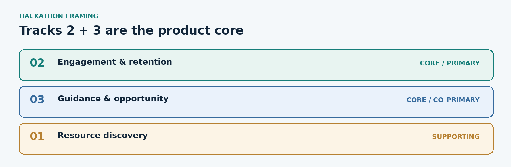

| Track | Priority | How the product addresses it |
|---|---|---|
| **2. Engagement & Staying in the Learning Journey** | **Primary / core** | Diagnose obstacles, give actionable next steps, adapt difficulty, support comprehension, build realistic recovery plans, and provide learner-controlled accountability. |
| **3. Guidance, Pathways & Opportunity** | **Co-primary / core** | Connect goals and demonstrated skills to credible opportunities; surface requirements, eligibility, gaps, portfolio tasks, and next actions. |
| **1. Access & Discovery** | **Enabling / secondary** | Use reliable supplemental materials, ranked against each learner's current need, device, data constraints, level, language, and the course they already follow. |

**Product interpretation:** Tracks 2 and 3 should reinforce each other, rather than exist as unrelated features. An opportunity can motivate the learner; successful learning creates new evidence and changes what opportunities make sense.

## 2. Problem, insight, and hypotheses

### The learner problem

A person trying to enter tech may experience a repeating chain: uncertain direction → resource overload → misunderstanding → stalled progress → low confidence → abandonment. Even after meaningful learning, they may not know where to find internships, projects, communities, conferences, scholarships, freelance work, or entry-level jobs — or whether they meet the actual requirements.

### Founder's important insight

**A learner may lose motivation not just because a topic is hard, but because they cannot see a credible way to *use* what they are learning.** The point of many tech-learning journeys is greater agency, income, and opportunity. Showing what a learner is working toward, without making false promises, may make the next difficult step feel worthwhile.

### Main product hypothesis (not yet validated)

> Learners who have stalled in their tech education will be more likely to resume and sustain meaningful progress when they receive personalized help with immediate obstacles *and* can see a believable connection between the skills they are developing and opportunities they could pursue.

### Supporting hypotheses

- A small relevant next action is often more useful than a newly generated six-month course.
- Respecting existing courses and prior progress lowers the friction of returning to learning.
- Feedback grounded in exercises and completed projects is better than relying on self-reported confidence alone.
- Opportunity visibility *before complete readiness* may increase motivation; eligibility and skill gaps must remain transparent.
- The choice of the next intervention matters more than simply providing a large library of content.

**These are design and research hypotheses, not proven user outcomes.**

## 3. Users and entry points

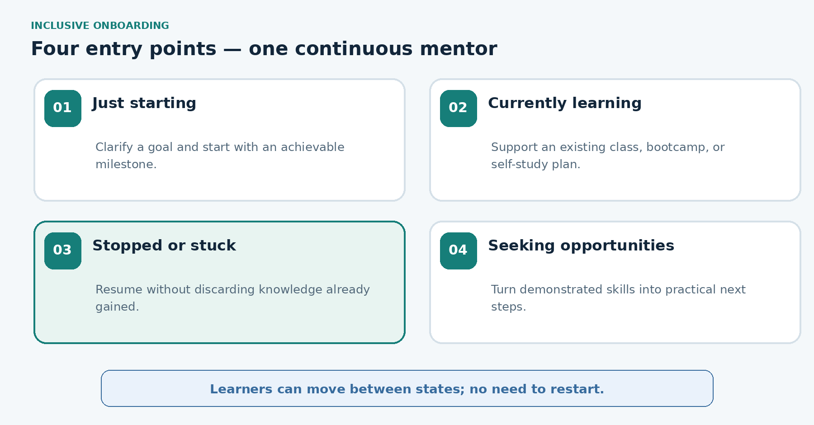

The product should support **four entry states**; these are not separate products or permanent labels.

| Entry state | Learner's situation | First helpful product behavior |
|---|---|---|
| **Just starting** | Wants to begin a tech skill and needs orientation. | Clarify a goal, evaluate relevant prerequisites gently, suggest a manageable beginning and why it matters. |
| **Currently learning** | Following a bootcamp, paid/free online course, university class, or personal study plan; needs support. | Capture learning context, identify gaps, explain difficult concepts, and provide accountability. |
| **Stopped or stuck** | Paused or abandoned a course, or keeps failing to progress. **Primary showcase persona.** | Recognize retained knowledge, identify the actual obstacle, and design a recovery milestone rather than force a restart. |
| **Seeking opportunities** | Has some skills and wants to use them professionally. | Inspect demonstrated skills, identify opportunities and requirements, and propose evidence-building tasks. |

**Design principle:** Learners can move between these states. The mentor should preserve continuity rather than classify people as beginners forever or interpret a pause as failure.

### Primary user constraints to design for

- Limited time, irregular schedules, work/school/family responsibilities.
- Unreliable connectivity, data costs, phone-first usage, or limited access to a laptop.
- Different languages, literacy levels, accessibility requirements, confidence, and educational backgrounds.
- An uneven learning history: some topics understood well, others forgotten or never learned.
- Financial and geographic constraints in accessing opportunities.

## 4. Positioning and product boundaries

### Positioning statement

**An AI learning and career mentor that meets learners wherever they are, helps them regain momentum, develop and demonstrate practical skills, and connect their progress to meaningful opportunities.**

### Learn anywhere. Get mentored here.

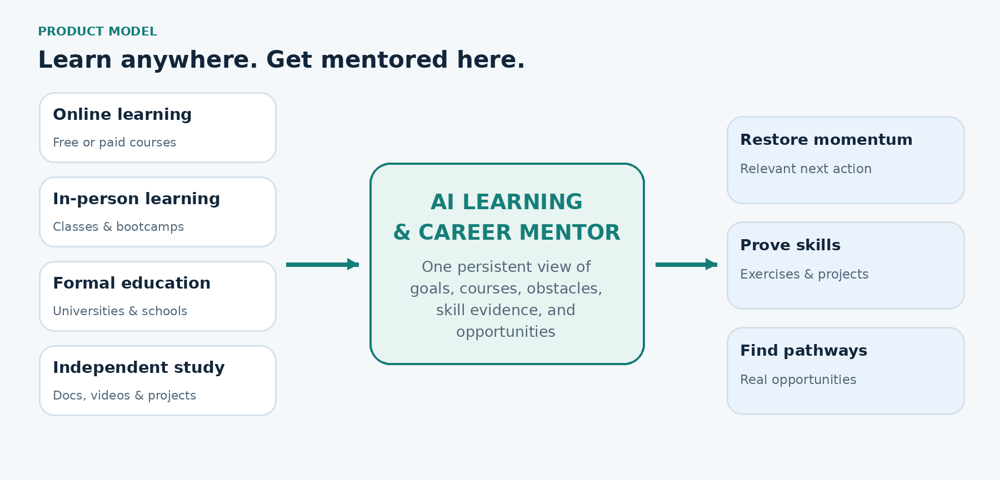

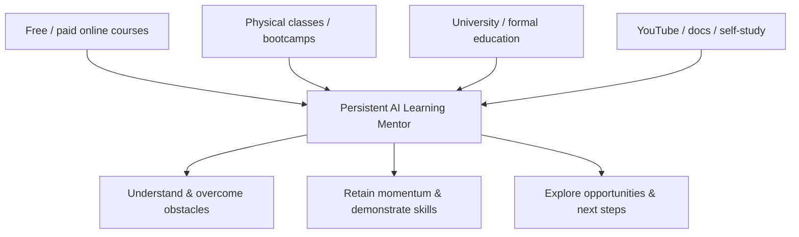

**Course-agnostic companion, not a replacement LMS.** Users may paste a syllabus, share a public course URL, describe their class, or upload permitted notes or assignments. The prototype need not authenticate into third-party platforms. Respect copyright, paywalls, classroom privacy, and terms of access; do not promise to scrape restricted materials or logins.

### Differentiation vs commodity AI features

AI roadmaps, content summaries, course recommendations, quizzes, and generic coaching are widely reproducible. Our **candidate advantage** is the system's ability to decide the **next useful intervention for a particular learner**, grounded in persistent learning context, evidence of competence, real-world constraints, and actual opportunities. This advantage must be demonstrated, not asserted as an established moat.

**Not our central claim:** “We have the largest list of courses” or “we rank the best resources for everyone.”  
**Our intended claim:** “We understand where you are, why you are stuck, what you can already do, and what will move you toward your goal next.”

## 5. The continuous mentorship loop

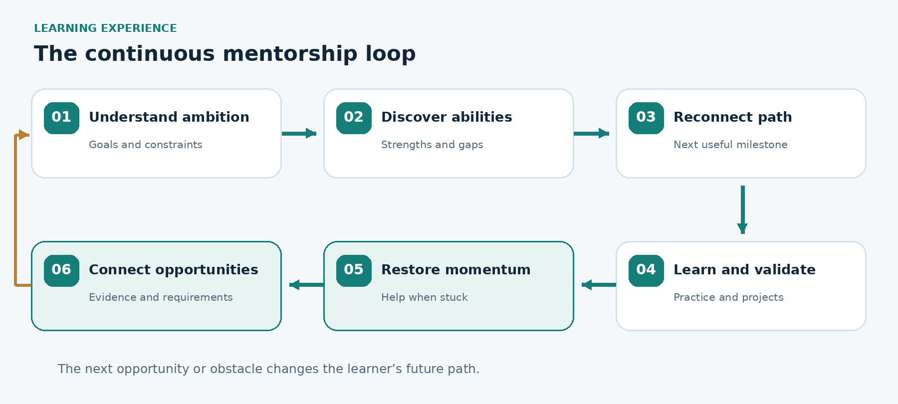

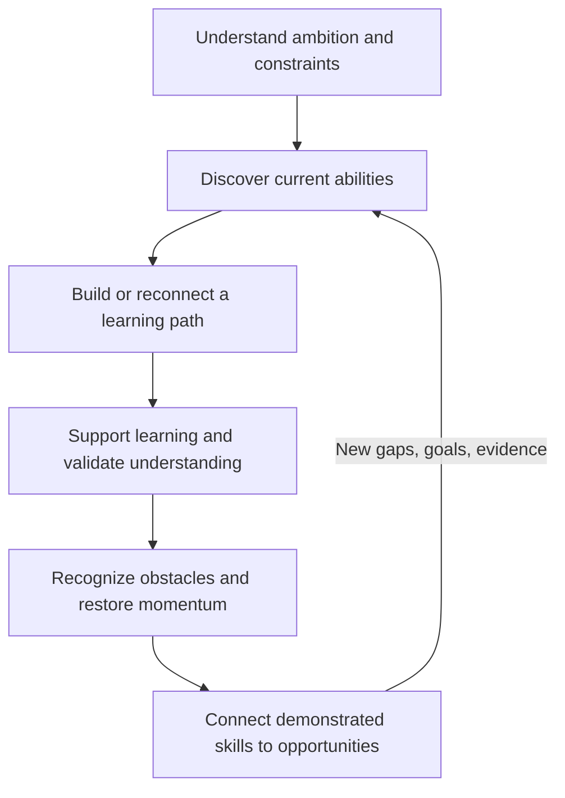

A path is a **living plan**, not a static AI-generated curriculum. A learner who already understands Python fundamentals should not be assigned an entire beginner curriculum. A learner who struggles with a prerequisite should not automatically be pushed forward because they completed an arbitrary chapter.

### Seven stages of the learner experience

1. **Understand the learner:** Goal, current journey, course/class context, desired outcomes, available time, devices, language, and motivations.
2. **Discover what they know:** A light, respectful diagnostic using short questions and, when appropriate, practical tasks; separate self-report from demonstrated evidence.
3. **Build or reconnect a path:** Link their existing course or create a new pathway; choose a small next milestone, not necessarily an entire course.
4. **Support daily learning:** Contextual explanation, exercises, tailored resources, small tasks, and progress visibility.
5. **Detect and respond to obstacles:** When confusion, repeated errors, missed plans, or requested help appear, propose a different explanation, smaller task, check-in, or recovery plan.
6. **Validate practical skills:** Quizzes, coding exercises, submitted projects, reflective explanation, and feedback; record evidence and uncertainty.
7. **Connect to opportunities:** Show genuine relevant opportunities and illustrative target roles, their requirements, learner skill evidence, remaining gaps, and recommended next tasks.

The last four stages operate as an ongoing feedback loop.

## 6. The two product engines

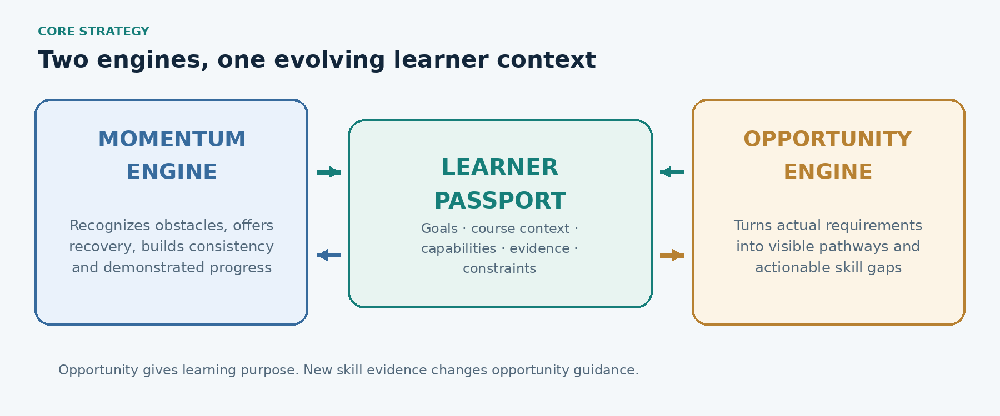

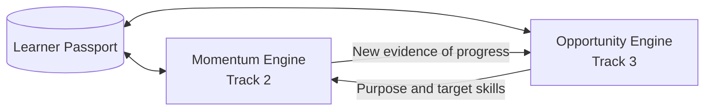

### 6.1 Momentum Engine — Track 2

**Job:** Help the learner maintain or restore real progress. It considers recent study activity, assessment results, stated obstacles, time constraints, task difficulty, and learner feedback. Useful interventions include:

- Explain the same idea differently, with examples relevant to the current course.
- Replace a difficult milestone with a smaller prerequisite task.
- Recommend a credible resource *specifically because* it addresses the learner's present gap.
- Offer a short recovery plan after a pause, preserving previous achievement.
- Suggest an opt-in check-in or reminder; allow quiet hours and opt-out.
- Reflect progress in demonstrated skills and completed work rather than just streaks.

**Guardrail:** Inactivity does not imply laziness, lack of intelligence, or demotivation. The product should ask and allow alternative explanations such as exams, work, family pressure, affordability, illness, or poor internet. Never shame or manipulate learners.

### 6.2 Opportunity Engine — Track 3

**Job:** Give learning a credible destination and turn capability gaps into actionable tasks. It matches goal, location, constraints, project evidence, and skills to opportunity requirements.

Opportunity types may eventually include jobs, internships, freelancing gigs, apprenticeships, scholarships, hackathons, open-source contributions, conferences, community programs, and portfolio opportunities.

**Crucial decision: show opportunities before a learner is fully ready.** The product can display categories such as **Ready to explore**, **Promising but gaps remain**, and **Strong evidence of readiness** — with specific justification. These labels are *guidance*, not hiring predictions, eligibility guarantees, or permission gates. Learners remain free to apply whenever an opportunity's own eligibility conditions allow it.

**Truthfulness:** Never invent a live posting, deadline, eligibility rule, compensation, or application link. Every live opportunity requires a traceable source and checked date; seeded or hypothetical opportunities must be visibly labeled.

## 7. The Learner Passport: continuity across learning

The Learner Passport is a **working concept**, not a chosen technology or database schema. It describes what context the mentor must retain with informed consent and user control.

| Dimension | Representative information | Evidence / caveat |
|---|---|---|
| Ambition | Target tech skill, role, professional goals | User-specified; may change |
| Learning context | Existing course, module, syllabus, instructor topic | User-provided or public/permitted inputs |
| Demonstrated strengths | Topics applied successfully in exercises/projects | Record source and date of evidence |
| Knowledge gaps | Topics missed or not yet demonstrated | “Not assessed” differs from “doesn't know” |
| Learning conditions | Time, device, connection, preferred format/language | Optional; adjustable |
| Engagement context | Last milestone, paused tasks, expressed frustrations | Do not infer personal traits from gaps |
| Skill evidence | Completed exercises, project links, assessment feedback | Distinguish completion from verified quality |
| Opportunity intent | Location, role type, interests, readiness goals | Respect restrictions and learner autonomy |

**The passport should be inspectable, editable, exportable, and deletable in the eventual product.** Collect only necessary information; do not persist unnecessary sensitive personal details.

## 8. Supportive resource discovery: contextual fit, not a link dump

Resources remain useful, especially when a learner needs a better explanation. For the prototype, use a **small vetted catalog** of free, legitimate, credible, attributable resources. Track source, topic, prerequisites, content format, language, accessibility, data requirements, and freshness.

A conceptual resource-fit model:

`resource_fit = f(credibility, current_skill_gap, prerequisite_match, accessibility, bandwidth_cost, language, learner_context)`

Put a **credibility threshold first**, then rank relevant resources. Explain *why* something was recommended. A 15-minute mobile learner may need a small text tutorial; someone debugging API code on a laptop may need a hands-on task. Do not claim an unverified numeric scoring model is academically validated.

**Do not scrape the whole internet for the MVP.** Do not bypass restricted course content. Paid courses can be *learning context* while the mentor suggests free supporting material.

## 9. Opportunity-driven learning in practice

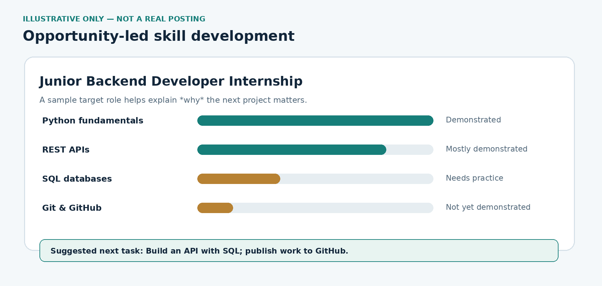

**Illustrative target only — not a real job posting:** Junior Backend Developer Internship.

| Skill requirement | Illustrative evidence state | Product response |
|---|---|---|
| Python fundamentals | Demonstrated | Recognize prior work |
| REST APIs | Mostly demonstrated | Set a practical validation task |
| SQL databases | Needs practice | Add an API + database project |
| Git & GitHub | Not yet demonstrated | Add version-control evidence |

**Mentor example:** “You're making progress toward this kind of role. Let's build a small API with a SQL database and publish it on GitHub. That will help you demonstrate two missing skills.”

This turns a generic lesson into a **reasoned step toward an outcome**. A later real opportunity comparison should explain eligibility and uncertainty, and avoid asserting employability based on a simplistic score.

## 10. Example learner experience: David (fictional)

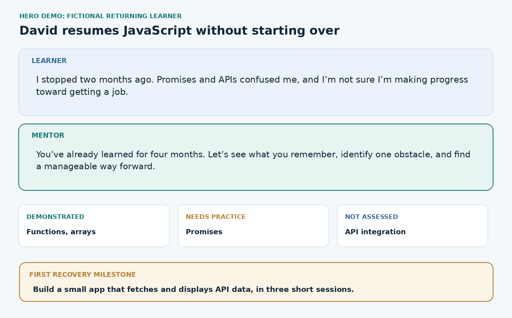

**Context:** David lives in Abuja, spent four months learning JavaScript, and paused two months ago when promises and API work became confusing. He doubts whether the effort will lead to employment.

**Opening:** “I stopped learning JavaScript two months ago. I was confused about promises and APIs, and I'm not even sure I'm making progress toward getting a job.”

**Mentor's response:** “You've already invested four months in JavaScript, so we don't need to assume you're a beginner. Let's identify what you still remember and where things became difficult. We'll start with a short practical exercise and then make a manageable plan.”

**Illustrative diagnostic (results are not real measurements):** Functions and array methods demonstrated; promises need practice; API integration not yet assessed.

**First recovery milestone:** Build a small app that fetches and displays data from an API, split into three short sessions: understand promises → fetch data → complete and review the app. Reuse his existing course, supplementing it only where helpful.

**Opportunity connection:** Show a representative frontend role requirement and how reliable API work and a published project strengthen evidence of skills. Do not invent actual postings.

**Disengagement scenario:** Simulate a missed week. The mentor asks what changed, helps David choose a shorter recovery task, and reconnects it to his goal — without guilt or false encouragement.

### Three showcase scenarios

| Scenario | What the prototype should visibly prove |
|---|---|
| **A — Beginner** | A new learner can choose a meaningful direction, receive a fair entry assessment, and start a small realistic milestone. |
| **B — Returning learner (hero demo)** | Prior learning is recognized; the mentor identifies a gap, offers an adaptive recovery task, evaluates evidence, and updates the plan/opportunity view. |
| **C — Opportunity seeker** | A learner's project evidence can be compared with transparent opportunity requirements, producing a usable skills-gap plan. |

## 11. Six-screen prototype structure

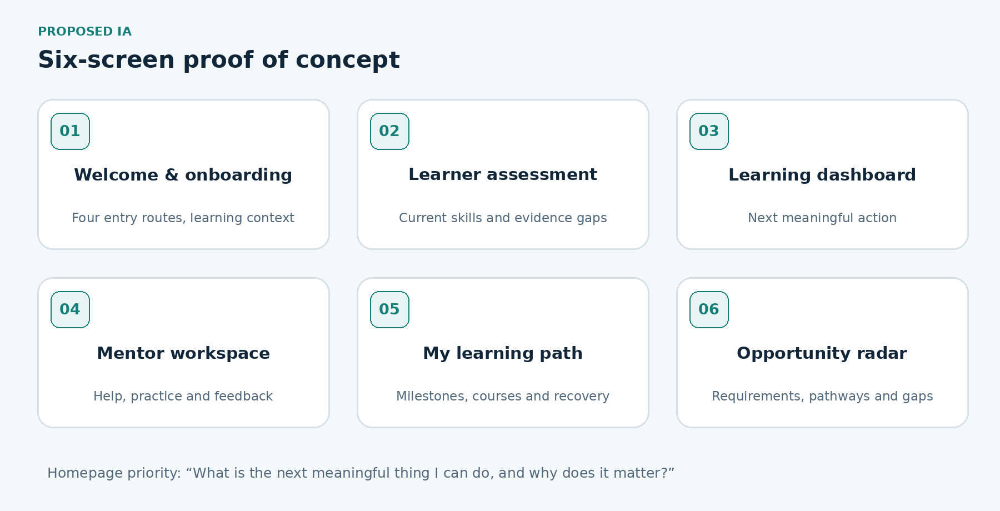

| Screen | Purpose | High-value elements |
|---|---|---|
| **1. Welcome & Onboarding** | Learn which of four entry states fits the learner. | Goal, existing course, stopped/stuck reasons, constraints |
| **2. Learner Assessment** | Get a defensible initial signal of what the learner knows. | Short adaptive diagnostic, practical question, skip option |
| **3. Learning Dashboard** | Show the next meaningful action and why it matters. | Today's task, milestone, evidence, motivating goal |
| **4. Mentor Workspace** | Provide contextual help and assess work. | Conversation, explanations, exercises, feedback |
| **5. My Learning Path** | Reconnect prior courses to evolving goals and milestones. | Existing syllabus, tasks, progress, recovery plan |
| **6. Opportunity Radar** | Make outcomes tangible and actionable. | Relevant sourced opportunities, requirements, skill gaps, suggested evidence |

**Homepage guiding question:** “What is the next meaningful thing I can do, and why does it matter?” Avoid a dashboard that is merely a wall of completion percentages.

## 12. MVP, boundaries, and demonstration requirements

This hackathon is an **invention sprint**. We are testing a working concept, not shipping a mature learning platform.

### In scope for proof of concept

- Four entry routes, with the most polished experience for a returning/stuck learner.
- One well-supported technical domain (proposed: frontend development).
- User-supplied course context by description, pasted syllabus, and optionally public/permitted links.
- A short skill diagnostic and explicit distinction between known, unknown, and unassessed skills.
- A persistent prototype Learner Passport.
- Dynamic milestones that change in response to assessments and completed exercises.
- AI mentor chat with course-aware explanations and at least one meaningful practical exercise.
- A visible stalled-learner intervention/recovery plan (can simulate inactivity rather than run live notifications).
- A small curated set of credible resources with reasons for recommendations.
- An Opportunity Radar using a *small source-verified/dated set* or clearly labeled fictional examples and skills-gap reasoning.
- Clear mobile-minded layouts and thoughtful handling of basic connectivity constraints.

### Explicitly out of scope for the hackathon

- Scraping every educational website or bypassing paywalls.
- Broad coverage of every tech skill or all languages.
- Deep integrations with paid learning platforms, physical classrooms, employers, or calendars.
- A production-scale recommendation pipeline, sophisticated dropout prediction, or real-time labor-market crawling.
- Automatic employment eligibility verdicts, guaranteed placement, or AI deciding who may apply.
- Advanced multi-agent architecture just for the sake of complexity.
- A full-featured LMS, social network, job board, or commercial billing system.

### Demo acceptance checks

1. Two learners with different demonstrated abilities can receive different next steps for the same broad goal.
2. A learner can link or describe an existing course and **continue from their current point**, not restart automatically.
3. Completing/failing a practical task changes at least one passport evidence item and one recommended action.
4. A simulated period of disengagement produces a respectful *recovery plan* rather than a generic reminder.
5. The opportunity view explains a match or gap using recorded skill evidence and explicit requirements.
6. Sources are attributed, and hypothetical examples are unmistakably labeled.
7. At least one important journey is usable in a mobile viewport and without video-only content.

## 13. Inclusion, safety, and operational design requirements

| Constraint | Early design response |
|---|---|
| **Quality & credibility** | Vetted resources, attributable links, clear uncertainty; source-check opportunity requirements. |
| **Low bandwidth** | Text-first guidance; short activities; avoid autoplay/video dependency; progressively load content; explore caching/offline read access. |
| **Accessibility & inclusion** | Keyboard/screen-reader-friendly UI, readable contrast, accessible alternatives, clear instructions; support varied literacy/digital confidence. |
| **Personalization without exclusion** | Learners can override paths, change goals, skip or retake checks; never permanently label capability from one quiz. |
| **Privacy & security** | Consent, data minimization, safe handling of academic/performance data; no needless sensitive info; future export/delete controls. |
| **Multilingual access** | Recognize English, French, Portuguese, Arabic, and local-language needs; prototype language coverage must be described honestly. |
| **Local relevance** | Consider geography, cost, data access, eligibility restrictions, and region-specific opportunities without stereotyping. |
| **Free learner access ambition** | The mission is free access to useful mentorship/skills; AI operations are not free, so a sustainable funding model remains an open question. |

## 14. Customer discovery: survey alongside building

**Goal:** Understand which obstacle is most severe in people's *actual past experiences* and what they've tried. Do not word questions just to elicit interest in an AI mentor. Run research in parallel with building; findings may change scope or intervention design.

**Practical initial target (not a statistically representative sample):** Roughly 20–30 survey responses and 5–8 deeper interviews, including learners who dropped out **and** people who returned successfully.

**What to analyze:** (1) most painful reported obstacle; (2) situations and behavior when learning stalled; (3) interventions people tried and what helped; (4) constraints an AI product cannot solve; (5) how progress and opportunities affect motivation.

### Google Form — working, user-edited question set

**Title:** Tech Learning Challenges — Tell Us Your Experience

**Description:** Have you ever started learning a tech skill but struggled to stay consistent, got confused about what to learn next, or weren't sure how to turn your knowledge into real opportunities? We're researching the challenges people face while learning tech skills, especially those who have paused, struggled, or abandoned their learning journey. We'd love to understand your experience. This survey takes approximately 4–5 minutes. Your responses will help us understand the problem better. You can respond anonymously unless you choose to leave your contact details.

**Q1. What tech skill have you been learning or tried to learn?**  
*Short answer.* Examples: Software development, UI/UX design, data analysis, cybersecurity, product management, etc.

**Q2. Which best describes your current learning situation?**  
*Multiple choice:* I'm learning and progressing consistently; I'm still learning, but struggling to make progress; I've temporarily paused my learning; I stopped learning the skill altogether; I've resumed learning after previously stopping; I've learned some skills but don't know what to do next; Other.

**Q3. How have you primarily been learning?**  
*Checkboxes, select all:* Free online courses or tutorials; paid online courses; physical classes or bootcamps; university or other formal education; YouTube, blogs, and documentation; learning independently through projects; Other.

**Q4. Think about the most recent time you struggled, slowed down, or stopped learning. What happened?**  
*Paragraph.* Tell us about your experience in your own words.

**Q5. Which ONE of these has been your biggest challenge while learning tech skills?**  
*Multiple choice:* Finding quality learning resources that suit my needs; staying consistent, motivated, and engaged in learning; knowing what direction to take in my learning journey; knowing how to turn my skills into opportunities; Other.

**Q6. Which specific difficulties have you experienced?**  
*Checkboxes, select all:* Too many resources; I didn't know which to choose; courses or tutorials were difficult to understand; I didn't know what to learn next; I struggled with discipline or consistency; I got stuck and had nobody to help me; I lost motivation because I wasn't seeing progress; I couldn't see how learning would lead to income or employment; I didn't know where to find relevant jobs, internships, or other opportunities; I wasn't confident I had the skills to apply for opportunities; internet, device, financial, or time constraints; Other.

**Q7. What was your main reason for learning this skill?**  
*Multiple choice:* Get a job or internship; earn money through freelancing; start a business or build a product; advance in my current career; academic requirements; personal interest; Other.

**Q8. If you've tried to find opportunities using your skills, what has been most difficult?**  
*Multiple choice:* Finding relevant opportunities; understanding their requirements; knowing whether I'm qualified; having enough practical experience or portfolio projects; location or eligibility restrictions; I've applied but haven't been successful; I haven't started looking for opportunities yet; Other.

**Q9. When you faced learning difficulties, what did you try to do to overcome them? Did it work?**  
*Paragraph, optional.*

**Q10. Looking back, what ONE thing would have made the biggest difference in helping you progress?**  
*Paragraph.*

*Survey status:* This reflects the latest edited question set. The form is not assumed published. The description currently mentions optional contact details, but the edited questions contain no completed opt-in contact question; resolve this wording before publishing (either remove the contact sentence or separately add a genuinely optional, consent-based contact field).

## 15. What to measure and validate

**During demo/usability testing** (observable short-term):

- Can learners explain their recommended next action and why it was chosen?
- Can they continue from prior knowledge without unnecessary restart?
- Does the skill diagnosis roughly correspond to performance on the exercise?
- Can a returning learner finish a small meaningful activity?
- Is the recovery message relevant and respectful?
- Can learners understand the evidence behind opportunity suggestions and identify the next gap to close?
- Does the experience function acceptably with constrained bandwidth/device assumptions?

**Longer-term outcomes** (cannot be established in one hackathon session): sustained participation, recovery after pauses, skill improvement on independently scored tasks, project completion, qualified applications, interviews, gigs, and opportunities actually accessed. Do not conflate clicks or streaks with learning.

## 16. Decision log and unresolved questions

### Decisions already made

1. This originated as the founder's AI learning mentor to help people learn tech skills for free and reach opportunities.
2. **Track 2 and Track 3** are the strategic focus. Track 1 supports them.
3. The primary audience is **people who have already started learning but stalled, become confused, disengaged, or lost direction**.
4. **Beginners are still welcome**; they do not define the hero hackathon scenario.
5. The mentor must work with **external free/paid courses and physical instruction**; it is not a closed course marketplace.
6. Resource discovery and quality ranking are useful, but **not positioned as the moat**.
7. Highlight opportunities **during learning**, even before full readiness; preserve learner agency and disclose gaps.
8. Build a **persistent Learner Passport** and two mutually reinforcing systems: the Momentum Engine and Opportunity Engine.
9. Build a compact, demonstrable proof of concept rather than a production platform.
10. Gather customer evidence via a non-leading survey and interviews **in parallel**, not as a blocker to starting the prototype.
11. The founder named the product **Meno** on 13 October 2026. Preserve this name in product-facing UI and code documentation.

### Working proposals, not locked decisions

- **Frontend web development** as the demonstration domain.
- **Six screens** as the initial interface organization.
- A **vetted static resource catalog** and small verified/seeded opportunity set for the MVP.
- “Learner Passport,” “Momentum Engine,” and “Opportunity Engine” as working internal names.

### Open questions to resolve during implementation

- What minimum learner data and evidence must be stored, and what are the permission boundaries?
- How should milestone planning, diagnostics, assessment, and opportunity matching divide responsibility between deterministic logic and the LLM?
- Which inputs can learners share safely from paid courses or classrooms?
- How do we evaluate code/project submissions affordably and fairly?
- What is the initial data source and verification policy for opportunities?
- What offline/mobile functionality is feasible in the hackathon timeframe?
- What is the schedule, team skill set, and allowed AI-development toolchain?
- How will the project sustain free learner access beyond the prototype?
- What initial learner-research findings should alter the next iteration?

## 17. Codex build handoff: instructions to future implementation work

Treat this document as **product context and strategic requirements**, read together with [`TECHNICAL_DESIGN.md`](TECHNICAL_DESIGN.md) for architecture, data boundaries, and the thin vertical slice. Preserve the product's priorities even when choosing pragmatic technical shortcuts.

**Build around the returning-learner story:** Onboard → import/describe existing course → diagnostic → evidence-backed Learner Passport → personalized recovery milestone → practical task and feedback → revised plan → transparent opportunity gap display.

**Important guardrails for Codex:**

- Do not turn the product into a generic course generator, content aggregator, social network, or job board.
- Do not make Track 1 the main pitch or resource rankings the defining feature.
- Keep beginner entry supported while the returning learner remains the principal demo.
- Don't invent live jobs, source claims, learning results, credentials, or assessment evidence.
- Never make a fictional opportunity appear as current or verified.
- Explain recommendations from **available evidence and current learner constraints**.
- Never equate inactivity with lack of motivation or ability; ask and offer choices.
- Do not gate learners from applying to jobs based on a model's readiness estimate.
- Don't bypass paywalls or capture private course material without proper permission.
- Design modestly for mobile, low-bandwidth text-first use and inclusion.
- Protect private progress and academic data; collect the minimum necessary.
- Use the proposed stack in `TECHNICAL_DESIGN.md` only after checking implementation constraints; do not introduce a complex agent system or make unsupported outcome claims based solely on this document.
- Mark prototype limitations visibly rather than silently presenting simulated behavior as production automation.

**Definition of a convincing first vertical slice:** A user who stopped learning JavaScript can bring a syllabus, complete a short skill check, receive a tailored next activity, submit a small task, see an updated plan, and understand one opportunity-related skill gap. That is more valuable than six screens of beautiful static content.

---

**Document ownership:** Founder-provided vision; AI-assisted strategy synthesis.  
**Purpose:** Durable product memory for Meno collaborators, hackathon presentation, and Codex implementation context.  
**Change control:** Update the decision log when strategic decisions change, rather than quietly rewriting earlier assumptions.
