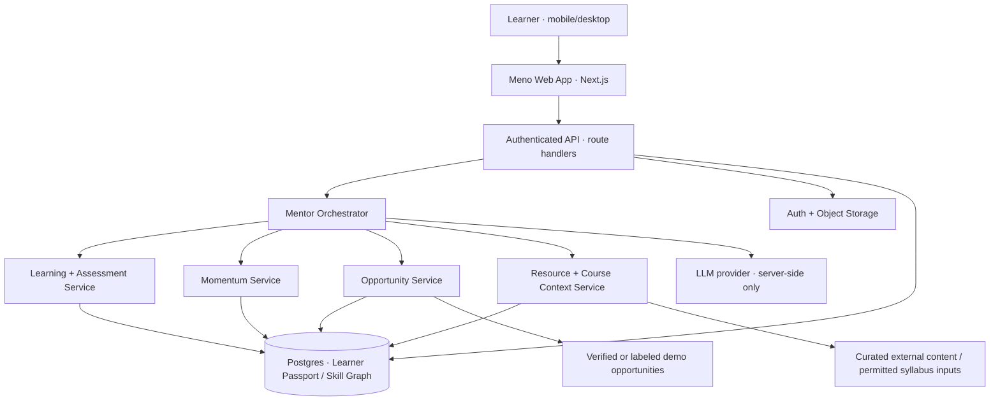
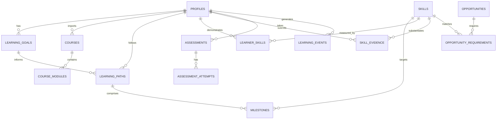
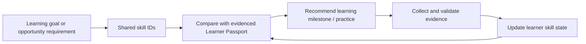

# Meno — Technical System Design

**Version:** 0.1 (implementation blueprint)  
**Date:** 13 October 2026  
**Status:** Proposed architecture; product name **Meno** and strategy priorities confirmed by founder  
**Companion document:** [`PRODUCT_STRATEGY.md`](PRODUCT_STRATEGY.md)  
**Source of truth:** The product strategy explains **why** and **for whom**; this document explains **how** the hackathon proof of concept should work. Resolve conflicts explicitly with the founder rather than silently choosing one document.

**Implementation update — 13 October 2026:** Bootstrap, Slice 1, C1's course-context API/database foundation, and C2's manual course editor/review are implemented. See the [course-context contract](COURSE_CONTEXT.md) for the learner flow, versioned schema, and routes. Most of this document remains the broader blueprint; AI extraction/mentoring, diagnostics, and opportunity matching are not yet available. See Section 16 for adopted implementation choices and the [implementation plan](IMPLEMENTATION_PLAN.md) for verified progress.

> **Meno's promise:** Learn anywhere. Get mentored here.  
> **Technical north star:** Preserve a learner's context, detect their next useful step, validate actual skill progress, and connect progress to credible opportunities.

## 0. Executive architecture decisions

| Topic | Decision / proposal | Status |
|---|---|---|
| Product name | **Meno** | **Confirmed** |
| Focus | Hackathon Tracks **2: Engagement** and **3: Guidance & Opportunity**; Track 1 enables them | **Confirmed** |
| Target | Stalled, confused, returning and opportunity-seeking tech learners; beginners also supported | **Confirmed** |
| Existing learning | Support paid/free courses, bootcamps, physical classes, universities and self-study | **Confirmed** |
| Product differentiation | Context-aware *next helpful intervention*, not the biggest resource directory | **Confirmed direction / hypothesis to test** |
| System shape | **Modular monolith**, not five microservices or many autonomous agents | **Recommended** |
| Initial stack | Next.js + TypeScript, Supabase Postgres/Auth/Storage, OpenAI API, Tailwind, Zod, Vercel | **Recommended; confirm before implementation** |
| Demo discipline | Frontend web development; JavaScript recovery as hero journey | **Working proposal** |
| AI coordination | One Mentor Orchestrator calling narrowly scoped services and structured AI functions | **Recommended** |
| Evidence policy | Do not change demonstrated skill status based on chat confidence or AI inference alone | **Required guardrail** |
| Opportunity data | Small verified dataset; illustrative entries explicitly labeled as hypothetical | **Required guardrail** |
| MVP | Returning learner imports outline → diagnosis → recovery task → evaluated work → updated learner context and opportunity-gap guidance | **Design target** |

**This is an invention-sprint implementation plan, not a production guarantee.** Start with one complete vertical slice and expand only when it works reliably.

## 1. System context

Meno is a **course-agnostic mentor**. It should work *alongside* a learner's existing educational material. The web application is the interface; the backend owns state, authentication, and permitted actions; the AI supplies contextual assistance rather than acting as an unbounded database administrator.



### 1.1 Architectural invariants

1. **Application data is authoritative.** The LLM reads selected learner context, proposes decisions, and explains them. Only validated application services persist changes.
2. **Every capability is permission-scoped.** The orchestrator can call named, typed functions; it cannot execute arbitrary SQL, read another user, fetch arbitrary internal URLs, or change security rules.
3. **Learning evidence is distinct from inference.** A learner saying "I know React," a passing quiz, a reviewed project, and an LLM's guess are different records with different evidentiary weight.
4. **Opportunity suggestions are transparent.** Keep eligibility requirements, source links, checked dates, demonstrated requirements, and unknowns distinct.
5. **The learner retains agency.** An AI-suggested revised plan or reminder should be optional; applying for an opportunity is never blocked by a model's readiness estimate.
6. **The primary demo works with poor connectivity and on small screens.** Default to short text and compact assets. Optional offline support must never falsely signal that unsynced work was saved remotely.

## 2. Logical components and responsibilities

The following are **modules inside one application**, not independent deployments.

| Component | Owns | Does *not* own |
|---|---|---|
| Mentor Orchestrator | Request routing, relevant context assembly, limited tool selection, response composition | Raw database writes, authorization decisions, arbitrary external browsing |
| Learner Passport | Learner goals, course history, current path, skill evidence, constraints, relevant events | Invented mastery or psychometric classifications |
| Learning & Resource Engine | Course import, skill mapping, milestones, vetted resources, contextual ranking, assessments | Circumventing paywalls or copying restricted courses |
| Momentum Engine | Observable difficulty/inactivity signals, opt-in check-ins, recovery suggestions | Diagnosing emotions from inactivity or manipulative streak mechanisms |
| Opportunity Engine | Eligibility checks, skill-to-requirement mapping, gap explanation, actionable next steps | Guarantees of employability or unverified live vacancies |
| Shared Skill Graph | Canonical skill identifiers, prerequisites, activity skill tags, opportunity requirements | Claims that a single skill score precisely determines employability |

### 2.1 One event stream connects the modules

Examples of domain events: `onboarding_completed`, `syllabus_imported`, `diagnostic_submitted`, `assessment_evaluated`, `milestone_completed`, `recovery_plan_accepted`, `opportunity_viewed`.

For the MVP, save these as rows in `learning_events`; process simple actions synchronously. **Do not introduce Kafka, message brokers, or event-sourcing infrastructure.** The event log is useful for auditability, recomputing progress, and explaining why recommendations changed.

## 3. User states and primary experience

The **entry state** is a temporary description of a learner's situation, not a permanent ability label.

- `starting` — Wants to begin. Get goal clarification, welcoming prerequisite check, and a first milestone.
- `active` — Learning through a course or self-study. Respect the existing syllabus and support it.
- `returning` — Paused or got stuck. Identify retained knowledge and generate a short recovery milestone.
- `opportunity_seeking` — Has skills and wants pathways. Map evidence to verified requirements and suggest meaningful gaps to work on.

All four use the same Passport, skills, milestones, mentor, and opportunity model. The **returning learner** is the hero hackathon demo.

### 3.1 Hero end-to-end sequence — David (fictional)

```mermaid
sequenceDiagram
    autonumber
    actor D as David (learner)
    participant UI as Meno web app
    participant API as Application API
    participant S as Passport / Skill services
    participant AI as Mentor + LLM
    participant O as Opportunity service
    D->>UI: "I stopped JavaScript after promises/APIs"
    UI->>API: Save goals, constraints and optional course outline
    API->>S: Create learner context and course outline draft
    API->>AI: Extract skill topics (structured output)
    AI-->>UI: Preview inferred topics; request learner correction
    D->>UI: Confirm syllabus; complete short diagnostic
    UI->>API: Submit assessment
    API->>S: Persist responses and evaluate checkable items
    API->>AI: Produce explanation + suggested recovery milestones
    AI-->>API: Typed proposal with evidence references
    API->>S: Validate and save learner-approved plan
    UI-->>D: Focused short recovery task + learning rationale
    D->>UI: Complete exercise / submit project evidence
    UI->>API: Submit answer or permitted artifact
    API->>S: Evaluate evidence + store outcome
    API->>O: Recalculate requirement gaps
    UI-->>D: Updated Passport, next step, opportunity gaps
```

**Visible success condition:** A user moves from a known obstacle to a meaningful completed task; the system can show *what changed and why* in the Learner Passport and gap explanation. A pretty dashboard without this behavior is not done.

## 4. Recommended technology stack

**Recommended stack, not an irreversible choice:**

- **Next.js App Router + TypeScript** — pages, server-rendered reads, and small API Route Handlers.
- **Supabase** — PostgreSQL, Auth, Storage, database migrations and Row-Level Security (RLS).
- **OpenAI API** — mentor responses, rubric-based feedback assistance, permitted course outline extraction, structured decision proposals. Use configured model names from environment, not hard-coded assumptions about the newest model.
- **Zod** — validate API requests, AI responses, and typed domain contracts.
- **Tailwind CSS + reusable UI components** — accessible mobile-first interface.
- **Vercel** — proposed hosting target; evaluate price limits and background-job needs before deployment.
- **Vitest (or equivalent) + Playwright** — unit/service and critical end-to-end tests.

Use the official documentation as implementation reference, not versions guessed from this document:

- Next.js Route Handlers: https://nextjs.org/docs/app/getting-started/route-handlers
- Supabase RLS: https://supabase.com/docs/guides/database/postgres/row-level-security
- OpenAI structured outputs: https://platform.openai.com/docs/guides/structured-outputs
- OpenAI function calling: https://platform.openai.com/docs/guides/function-calling

**Not in MVP:** Kubernetes, separate microservices, autonomous multi-agent frameworks, a web-scale crawler, a custom ML ranking model, or a separate vector database. Add embeddings/pgvector only if the curated catalog outgrows metadata filtering.

## 5. Data model and Learner Passport

### 5.1 Minimum entities

**MVP-first physical tables** (can be revised during migrations):

| Table | Important fields (conceptual; not final SQL) | Key behavior |
|---|---|---|
| `profiles` | `id` = Auth user ID, `display_name`, `locale`, `study_minutes_per_week`, `device_constraints`, `created_at` | Owner-readable/writable; keep optional fields optional |
| `learning_goals` | `id`, `user_id`, `target_role`, `desired_skill`, `motivation`, `status` | Multiple goals possible; one active in MVP |
| `skills` | `id`, `slug`, `name`, `description`, `domain` | Canonical shared taxonomy, seeded |
| `skill_prerequisites` | `skill_id`, `prerequisite_skill_id` | Directional dependency; prevent cycles in seed data |
| `learner_skills` | `user_id`, `skill_id`, `status`, `last_evidence_id`, `updated_at` | Separate `not_assessed`, `learning`, `needs_review`, `demonstrated`; do not equate unknown with weak |
| `skill_evidence` | `id`, `user_id`, `skill_id`, `kind`, `source_id`, `outcome`, `evaluated_at`, `rubric_version` | Track which assessment/project actually supports a claim |
| `courses` | `id`, `user_id`, `title`, `source_type`, `source_url`, `import_status` | External course references; avoid ingesting inaccessible paywalled content |
| `course_modules` | `id`, `course_id`, `position`, `title`, `topics`, `mapped_skill_ids` | Editable extraction preview; learner can correct |
| `learning_paths` | `id`, `user_id`, `goal_id`, `status`, `revision` | Version current roadmap |
| `milestones` | `id`, `path_id`, `skill_id`, `title`, `status`, `estimated_minutes`, `position`, `rationale` | Small actionable next steps; planned/in_progress/completed/skipped |
| `assessments` | `id`, `user_id`, `type`, `skill_scope`, `status` | Diagnostic or task-based, with timestamps |
| `assessment_attempts` | `id`, `assessment_id`, `user_id`, `answer_ref`, `evaluation`, `rubric_version` | Record actual work and limits of grading |
| `resources` | `id`, `url`, `title`, `provider`, `skill_ids`, `difficulty`, `format`, `data_cost`, `quality_status`, `checked_at` | Curated, provenance-rich sources |
| `opportunities` | `id`, `title`, `organization`, `location`, `source_url`, `deadline`, `verification_status`, `checked_at`, `is_demo` | Live or clearly hypothetical, never mixed silently |
| `opportunity_requirements` | `id`, `opportunity_id`, `skill_id`, `requirement_type`, `details` | Required/preferred skill plus explicit non-skill eligibility |
| `learner_opportunities` | `user_id`, `opportunity_id`, `saved_at`, `application_status` | Learner's relationship to an opportunity |
| `learning_events` | `id`, `user_id`, `type`, `entity_id`, `payload`, `occurred_at` | Explainable history; bounded payload and retention |
| `mentor_messages` | `id`, `user_id`, `conversation_id`, `role`, `content`, `created_at` | Scoped messages; store only if required by MVP |

**Possible later tables:** `interventions`, `notification_preferences`, `scheduled_checkins`, `resource_feedback`, `imported_documents`, `organizations`, `application_outcomes`. Don't model these prematurely if an event row or profile preference suffices for the first slice.

### 5.2 Entity relationships



### 5.3 Skill status and evidence rules

- `not_assessed`: No reliable evidence yet. **Not** a failure.
- `learning`: Learner is working on the skill or has only self-report/partial evidence.
- `needs_review`: Exercise shows a material gap; can retry and improve.
- `demonstrated`: Meets a defined, versioned rubric or objective test threshold for a scoped ability.
- Add `confidence` only if its method and meaning are documented; avoid invented percentages.
- Record `evidence_kind` (self-report, quiz, practical task, externally verified project), rubric/assessment version, date, and caveats.
- **Never** promote a skill to `demonstrated` merely because the mentor wrote a confident-sounding explanation.
- Accept user correction of goals and imported course topics; preserve a record of important system-generated modifications.

### 5.4 The shared skill graph

Seed **10–20 skills** for one frontend JavaScript curriculum and their prerequisites. Example IDs: `web.html-basics`, `web.css-layout`, `js.variables`, `js.functions`, `js.arrays`, `js.promises`, `js.async-await`, `web.http-basics`, `web.fetch-api`, `web.dom`, `git.basics`, `react.components`.

The exact taxonomy is provisional. Avoid implying React is required for every internship. Every learning milestone and every skill requirement can reference the same canonical `skill_id`; that's how the Momentum and Opportunity Engines share context.

## 6. AI orchestration: controlled reasoning, not autonomous writes

### 6.1 Request-processing contract

1. Authenticate learner and authorize operation.
2. Validate and normalize the request.
3. Fetch *minimal relevant context*: active goal, current milestone, 3–5 recent events, relevant skills/evidence, course topics, resource preferences, and (when relevant) candidate opportunity requirements.
4. Classify intent: `explain`, `diagnose`, `recommend_resource`, `plan_recovery`, `evaluate_task`, `explore_opportunity`, or `clarify`.
5. Call a narrowly scoped service and/or structured model response.
6. Schema-validate output, enforce eligibility/evidence/source policies, and reject unknown IDs.
7. Show rationale, citations/source URL where applicable, and explicitly ask learner to confirm consequential plan changes.
8. Persist **only validated, authorized changes**, logging a small event for explainability.

### 6.2 Suggested internal tool capabilities

Use typed server functions such as:

```text
getLearnerContext(userId, skillIds?)
getCurrentLearningPath(userId)
getCourseTopics(userId, courseId)
getSkillEvidence(userId, skillIds)
findCuratedResources({ skillId, difficulty, modality, bandwidth })
proposeMilestone({ userId, skillId, durationMinutes, reason })
evaluateAssessment({ userId, attemptId, rubricId })
compareOpportunityRequirements({ userId, opportunityId })
createLearningEvent({ userId, type, validatedPayload })
```

Only trusted server code supplies `userId`, derived from the authenticated session. Never accept it from an LLM tool argument or a client as authorization.

### 6.3 Typed AI decision example

```ts
// Illustrative structure, not a finished implementation.
type MentorDecision = {
  schemaVersion: 1;
  action: "explain" | "recommend_practice" | "propose_recovery" | "show_opportunity_gap";
  targetSkillId?: string;
  rationale: string;
  resourceIds: string[];       // Must refer to catalog rows already retrieved.
  evidenceIds: string[];       // Must refer to accessible learner evidence.
  proposedMilestone?: {
    title: string;
    estimatedMinutes: number;
    successCriteria: string[];
  };
  needsLearnerConfirmation: boolean;
};
```

Validation requirements: `schemaVersion` supported; enums strict; limits on string size and array length; resource/evidence IDs exist and are authorized; no unsupported factual assertions; estimated time bounded; correct consent gate for plan modifications. If the model fails, do not persist a partial decision. Offer a conservative non-AI fallback (the current milestone, a selected vetted resource, or "please retry").

### 6.4 Context window and cost management

- Never send the entire conversation or full course text by default. Fetch and summarize only current context, with source references.
- Do not let pasted syllabi or web pages override the system's rules; treat them as **untrusted data**.
- Enforce input lengths, per-user rate limits, model token ceilings, and server timeouts.
- Cache static resource metadata and shared skill taxonomies; do not cache another learner's personalized output as if it belongs to the current learner.
- Use model selection via environment configuration so latency/cost can be tuned without code changes.

## 7. Learning & Resource Engine

### 7.1 External-course ingestion

MVP flow: learner enters a title, source type, optional publicly accessible URL, and *pastes or uploads permitted syllabus text*. The app extracts candidate module titles/topics and maps topics onto seeded skills. **Show an editable preview** before saving; where mapping is uncertain, label the uncertainty.

Do not fetch paywalled content without a lawful integration, assume access to account-protected course pages, import restricted copyrighted lessons wholesale, or execute instructions embedded inside uploaded materials. Keep uploads small and accepted formats narrow for the demo.

### 7.2 Resource selection and ranking

1. Filter for credible, reachable sources with provenance and a valid topic/skill match.
2. Honor learner constraints (language, video vs text, bandwidth, device, time).
3. Apply an **illustrative** fit score to remaining resources:

```text
score = .35 * topic_relevance
      + .25 * difficulty_fit
      + .20 * accessibility_fit
      + .20 * existing_course_alignment
```

Each component must be defined on a consistent 0–1 scale; missing metadata should lower confidence or cause human review, not become a fabricated high score. Weights are starting hypotheses, not validated science. **Quality is a minimum gate first**, not a cosmetic scoring feature.

Return: `resource_id`, `source_url`, title, format, estimated duration (only if verified), reason for recommendation, and a clear fallback if link is inaccessible. The product's advantage is choosing an *appropriate intervention*, not winning generic search rankings.

### 7.3 Paths and assessments

- A path is a revisioned set of skill-oriented milestones. Treat edits as new revisions or logged modifications.
- Assess only what can be observed. Begin with short objective questions plus a small structured practical task.
- Simple questions can be scored deterministically. For open-ended work, use an explicit rubric and display limitations of AI-assisted evaluation.
- **Do not execute arbitrary submitted code in the main web server.** For the hackathon, use safe fixed test cases for limited exercises, repo/link review with caveats, or an isolated/sandboxed grader only if the team can build it safely.
- Distinguish **task completed** from **skill demonstrated**; promotion to `demonstrated` requires applicable evidence and rubric criteria.

## 8. Momentum Engine (Track 2)

### 8.1 Inputs

Observable events: incomplete milestone by planned date, repeated errors in the same topic, user-declared frustration, explicit request for help, a return after a break, or limited study time. These are learning-state signals, **not diagnoses of motivation or mental health**.

### 8.2 Example intervention policy

| Evidence/signal | Safe first action | When to use AI |
|---|---|---|
| Learner explicitly says "I don't understand promises" | Retrieve current lesson/skill and ask one clarifying question or offer practice | Tailored explanation and analogy |
| Repeated wrong answers | Offer a shorter prerequisite exercise | Generate alternative explanation tied to observed error |
| Missed planned session | Ask whether availability changed; offer replanning | Draft smaller recovery milestone *after learner opts in* |
| Returning after weeks away | Offer a short retention check | Propose re-entry based on actual results |
| Unclear connection to goal | Show a relevant required skill/project from a genuine or explicitly demo opportunity | Explain connection without promising a job |

### 8.3 MVP reminders versus later automation

**MVP:** In-app check-in, seeded `milestone_missed` demo event, learner-approved recovery-plan change. Clearly label simulated inactivity during judging.

**Later:** Opt-in scheduled email/push/WhatsApp workflows with timezone-aware preferences, quiet hours, delivery logs, unsubscribing, and provider compliance. Do not imply future outbound notifications are already operating.

## 9. Opportunity Engine (Track 3)

### 9.1 Catalog and verification

A valid live record needs a real source URL, organization, title, eligibility criteria, location/remote constraints, retrieved or checked date, and a deadline where verifiable. If that cannot be established, mark it `unverified` or `demo`. Never display a demo vacancy as an open real-world job.

For MVP, use a small curated/seeded dataset; explicitly mark sample opportunities. Broad crawling, application automation and live feeds are outside scope.

### 9.2 Matching logic

1. Check explicit *non-skill* eligibility (location, citizenship, education, deadline) when provided; if unknown, display **Needs verification**.
2. Compare required skill IDs with `learner_skills` and their evidence; keep **not assessed** separate from **needs work**.
3. Separate **required**, **preferred**, and **portfolio/project** evidence.
4. Explain gaps in words and propose one achievable task that addresses a real requirement.
5. Show the source, verification time, and uncertainty; never calculate an authoritative "chance of hiring" from weak evidence.
6. Permit the learner to explore and apply regardless of an AI readiness suggestion.

Example categories: `explore_now`, `potential_fit_with_gaps`, `strong_evidence_for_some_requirements`, `eligibility_unverified`. These are explanatory labels, not gates.

### 9.3 Shared skills drive two-way adaptation



**Acceptance test:** Finishing one assessed JavaScript API task alters the opportunity gap description where and only where that evidence supports a requirement.

## 10. API surface and backend contracts

Proposed route names (use RESTful patterns where practical; do not create endpoints before needed):

| Method | Route | Responsibility |
|---|---|---|
| `GET` / `PATCH` | `/api/me` | Read/update allowed profile preferences |
| `POST` | `/api/onboarding` | Save entry state, learner goal and constraints |
| `POST` | `/api/courses/import` | Parse supplied course outline into a draft |
| `POST` | `/api/courses/:id/confirm` | Confirm/correct mapped modules and skills |
| `POST` | `/api/assessments` | Start diagnostic for selected skill scope |
| `POST` | `/api/assessments/:id/attempts` | Submit and evaluate answers/evidence |
| `GET` | `/api/learning-path` | Return active path, milestones, reasoning |
| `POST` | `/api/learning-path/revisions` | Propose or accept a recovery revision |
| `POST` | `/api/mentor/messages` | Submit question, retrieve focused context, respond |
| `GET` | `/api/opportunities` | List real verified and/or clearly flagged demo records |
| `GET` | `/api/opportunities/:id/match` | Evidence-backed requirements and gaps |

Each mutation uses a schema (Zod), authenticated user ID from server context, owner checks, idempotency for retried submissions where needed, and consistent error codes. At first, combine closely related endpoints if doing so simplifies the vertical slice without blurring authorization.

### 10.1 Example assessment evaluation response

```json
{
  "assessmentId": "assessment_123",
  "status": "evaluated",
  "skillFindings": [
    {
      "skillId": "js.promises",
      "status": "needs_review",
      "evidenceId": "evidence_456",
      "rationale": "The learner mixed up promise resolution order in two test cases."
    }
  ],
  "nextMilestoneId": "milestone_789",
  "limitations": ["This is a short diagnostic, not a comprehensive certification."]
}
```

IDs and content above are **illustrative only**, not values to seed as real user records.

## 11. Trust, security, accessibility and operational constraints

### 11.1 Security and privacy

- Enforce **RLS on every exposed private table**, plus scoped `SELECT`, `INSERT`, `UPDATE`, `DELETE` policies and appropriate database grants. Server-side service-role secrets must never reach the browser.
- Read user ID from the authenticated session, not from an AI-proposed action, URL, or form field.
- Store uploaded materials in private buckets; authorize downloads and sanitize text. Protect against prompt injection in public webpages, uploaded syllabi, resource descriptions and job postings.
- Offer a basic user-controlled delete/export path in the mature product; in the MVP, at minimum document stored fields and provide a way to erase demo user data.
- Do not collect details like family circumstances or mental health merely to personalize nudges. Ask only for useful learning constraints.
- Avoid leaking user data through analytics, model logs, error messages, console output, or cross-user caches.
- Record only bounded decision explanations and evidence references; implement sensible retention when moving beyond the demo.

### 11.2 Accessibility and inclusion

- Work with keyboard and screen readers; labels, contrast, focus, simple navigation, error states.
- Make explanations available as text. Avoid mandatory video and heavy downloads.
- Store language preference; design UI copy and prompts for future English/French/Portuguese/Arabic/local language support without claiming full translation exists in MVP.
- Do not permanently label learners as "slow," "weak," or low-potential.

### 11.3 Low bandwidth and offline behavior

- Text-first interface, server pagination, lazy-loading, minimal images and lightweight responses.
- Use resumable forms/drafts. If local draft storage is introduced, label pending synchronization and avoid persisting sensitive data insecurely.
- For a small MVP, **graceful reconnection** is enough; a complete offline LMS is out of scope.

### 11.4 Reliability and observability

- Give clear errors and retry actions for missing LLM response, failed URL, API timeouts, partial assessment saves and broken sources.
- Keep correlation/request IDs and redacted audit events; never log access tokens, raw private uploaded coursework, or full conversations by default.
- Instrument key events: onboarding completed, assessment started/completed, milestone accepted/completed, recovery intervention chosen, opportunity viewed.
- Distinguish activity metrics from real learning outcomes. Record both successful and rejected AI decisions for debugging, without retaining unnecessary personal text.

## 12. Repository structure — preserve this layout

This is the **canonical target structure** for Codex to scaffold. The ZIP handoff intentionally contains **documentation only**; the directories below are the planned app layout, not claims of completed code.

```text
meno/
├── AGENTS.md                      # Codex's standing implementation instructions
├── README.md                      # Setup + handoff
├── docs/
│   ├── PRODUCT_STRATEGY.md        # Product truth, users, journeys, research, visuals
│   ├── TECHNICAL_DESIGN.md        # This architecture + contracts
│   └── assets/                    # Eight strategy diagrams
├── src/
│   ├── app/
│   │   ├── onboarding/
│   │   ├── assessment/
│   │   ├── dashboard/
│   │   ├── mentor/
│   │   ├── learning-path/
│   │   ├── opportunities/
│   │   └── api/                   # Next.js Route Handlers
│   ├── components/                # Shared accessible UI
│   ├── features/
│   │   ├── learner-passport/
│   │   ├── assessment/
│   │   ├── learning-paths/
│   │   ├── momentum/
│   │   ├── opportunities/
│   │   └── resources/
│   ├── lib/
│   │   ├── ai/
│   │   │   ├── orchestrator.ts
│   │   │   ├── prompts/
│   │   │   ├── tools/
│   │   │   └── schemas/
│   │   ├── db/
│   │   └── auth/
│   └── types/
├── supabase/
│   ├── migrations/
│   └── seed.sql
└── tests/
    ├── unit/
    ├── integration/
    └── e2e/
```

**Implementation boundary:** UI pages render application state; `features/` own domain behavior; `lib/ai/` owns model adaptation and schemas; `lib/db/` handles persistence; route handlers authenticate/validate and call domain services. Do not bury business logic inside React components or model prompts.

The original strategy diagrams remain editable: Mermaid in `PRODUCT_STRATEGY.md` and PNGs under `docs/assets/`.

## 13. Vertical-slice implementation roadmap

### Slice 1 — Learner Passport foundation

Deliver onboarding for four entry states, one active goal, saved profile/preferences, one demo frontend skills taxonomy, database migrations, login/session handling and basic dashboard.

**Done when:** A learner can sign in, establish a goal, view a consistent Passport, and return to it after a new session; private records are inaccessible to another test user.

### Slice 2 — Import, assess, build a recovery plan

Allow returning users to paste a course outline, edit extracted topics, take a short JavaScript diagnostic, store concrete findings, and receive one appropriately sized milestone.

**Done when:** Two sample learners with different demonstrated gaps receive distinguishable tasks, with reasons traceable to their evidence.

### Slice 3 — Mentor and Momentum

Add context-aware mentor messages, selected credible resources, one observable obstacle, a user-approved recovery revision, and a short practical submission with documented grading limits.

**Done when:** The user can complete an activity, see new evidence and a revised milestone, and understand why the system changed its recommendation.

### Slice 4 — Opportunity Radar

Add a small catalog, verified/demo labels, source-aware skill requirements, requirement matching, gap explanations, and one directly connected next activity.

**Done when:** Assessment evidence changes only the matching requirements it supports; no live job is invented, and applying is not gated by an AI score.

### Slice 5 — Demo, resilience and validation

Demonstrate beginner, returning, and opportunity-seeking paths; mobile layout; two-user data isolation; injected bad content handling; broken links; LLM unavailable fallback; and short user tests.

**Done when:** David's full story runs end-to-end without manual database edits between stages. Clearly mark seeded demo data and simulated events.

## 14. Testing and evaluation strategy

| Layer | Minimum tests |
|---|---|
| Domain logic | Skill evidence transitions; prerequisite logic; ranking filters; eligibility vs skill matching; milestone revision rules |
| Authorization | Cross-user read/write attempts rejected; server-only model key; RLS policies for every private table |
| AI schemas | Unknown resource IDs rejected; invalid enum/type rejected; prompt injection in imported text ignored; failure falls back safely |
| Assessments | Correct/incorrect responses; partial work; repeat attempts; rubric version saved; not-assessed distinct from failed |
| Opportunity integrity | Missing deadlines marked unknown; closed or unverified job not sold as open; demo opportunities visibly labeled |
| E2E journeys | Beginner onboarding; returning JavaScript hero; learner with skills exploring opportunities |
| Usability | Mobile data/time constraints; actionable next task comprehensible; keyboard and screen-reader basics |
| Cost/reliability | Provider timeout, rate limit and request-size cap; retry doesn't double-post evidence |

**Metrics:** Completion of one meaningful activity; clarity of recommendation; correct skill-evidence transitions; time to resume after a simulated pause; usefulness of gap explanation. **Not yet measurable from a single demo:** long-term retention, employment outcomes, or proof that Meno improves earning power.

## 15. Development fixtures and truthful demos

Use explicitly seeded demo users/data, with no suggestion they're actual learners or results:

- **David:** JavaScript learner returning after a pause; functions/arrays demonstrated; promises and API integration need review; limited time; follows an existing syllabus.
- **New learner:** Wants frontend development, not previously assessed. Gets a beginner-appropriate first step, not David's recovery plan.
- **Opportunity seeker:** Has demonstrable skills and a portfolio artifact; receives opportunities and explanations linked to real requirements or clearly demo requirements.
- **Opportunity records:** Prefer verified real examples with source dates. If seeded fictional examples are used, add prominent `DEMO — NOT A LIVE LISTING` labeling.

Never fabricate user metrics or call a rubric-based assessment a certification.

## 16. Open implementation choices and change log

These are **questions Codex should surface briefly**, but they should not be used to indefinitely postpone a safe first vertical slice:

- Confirm frontend/hosting stack (recommendation: Next.js + Supabase + OpenAI API + Vercel).
- Authentication entry: email/password or magic link for hackathon testers?
- What cost ceiling and provider/API keys are available?
- What exact JavaScript diagnostic and project rubric will be used?
- Which *genuinely usable* resource links can be seed-verified?
- Will opportunity listings be verified real ones or clearly marked demo entries?
- What user-upload format is practical and lawful (pasted outline first)?
- Is there time for reminder delivery beyond in-app check-ins?

**Current changes:**

| Date | Change | Status |
|---|---|---|
| 13 Oct 2026 | Product named **Meno** | Founder confirmed |
| 13 Oct 2026 | Preserved Tracks 2 + 3 emphasis, beginner support and course independence | Founder confirmed |
| 13 Oct 2026 | Established technical blueprint and repo structure for Codex | Proposed for implementation |
| 13 Oct 2026 | Adopted Next.js 16.4, React 19, TypeScript, Tailwind 4, Zod 4, and npm with exact dependency versions and one lockfile | Implementation choice after authorization to proceed; no additional product commitment implied |
| 13 Oct 2026 | Local Supabase/Postgres 17 with email/password authentication and cookie sessions; local email confirmation disabled for development | Implemented locally; hosted auth, email, and deployment remain unconfigured |
| 13 Oct 2026 | Atomic `save_passport` function derives authenticated identity, serializes each learner's saves, deduplicates request IDs, and enforces one active goal | Implemented and tested, including concurrent saves and rollback |
| 13 Oct 2026 | Persisted four entry states and optional learning constraints; seeded 14 frontend skills and acyclic prerequisites; added scoped evidence foundations | Implemented; learners begin with all skills not assessed |
| 13 Oct 2026 | Restricted private tables with grants and RLS; clients cannot insert assessed evidence or promote their own skills | Actual anonymous, authenticated, and cross-user database tests pass |
| 13 Oct 2026 | Adopted Biome, Vitest, and Playwright with local Supabase tests and a CI workflow | Local lint/type/unit/database/browser checks pass; C1's remote CI passed on PR #1 |
| 13 Oct 2026 | Use feature branches for changes instead of committing directly to `main` | Founder requested; recorded in `AGENTS.md` and the contribution workflow |
| 13 Oct 2026 | C1 uses `courses`, retained `course_revisions`, and revision-scoped `course_modules`; confirmed context remains separate from later drafts | Implemented on `feat/course-context-foundation`; API and database tests pass |
| 13 Oct 2026 | Bounded course save/confirm functions derive identity, validate shared skill references and checkpoints, compare revisions, and persist retry fingerprints/results with history events | Implemented and tested for direct RPC input, ownership, rollback, duplicate requests, and concurrency |
| 13 Oct 2026 | `GET/POST /api/courses`, `GET/PUT /api/courses/{id}`, and `POST /api/courses/{id}/confirm` precede the course editor and extraction | Implemented; reference URLs are stored only, and course input does not create assessment evidence |
| 13 Oct 2026 | C2 adds private course list/new/review pages, manual mapping, module order and checkpoint editing, and explicit saved-version confirmation | Implemented on `feat/course-editor`, based on merged C1; no schema migration or AI configuration required |
| 13 Oct 2026 | Preserve unsaved form data on conflicts; require explicit comparison/replacement; reuse uncertain request IDs and reread current state after receipts | Browser checks cover competing saves/confirmations, lost responses with intervening edits, cancel, mobile entry, and returning sessions |

AI extraction, OpenAI integration, hosting, diagnostic rubrics, recovery milestones, and opportunity matching remain future work. These implementation choices record what was built under the instruction to proceed; they do not relabel the remaining proposals as founder-approved decisions.

## 17. Codex start instruction

**Read [`PRODUCT_STRATEGY.md`](PRODUCT_STRATEGY.md), this file, and repository `AGENTS.md` before coding.** Treat the diagrams in `docs/assets/` as references. Then:

1. Summarize the confirmed product invariants and suggested implementation choices in a short implementation plan.
2. Scaffold the modular-monolith repository in **Section 12** without inventing extra microservices.
3. Build **Slice 1 and the beginning of Slice 2**, starting with a secure Learner Passport and returning-JavaScript-learner flow.
4. Add seed data, migrations, clear setup/environment instructions, automated tests and observable acceptance checks.
5. Flag unverified assumptions explicitly. Never silently convert a proposal into a founder-approved product decision.

**First working demo:** A learner brings prior context, demonstrates what they remember, receives a tailored recovery activity, completes it, and sees evidence-backed next steps. Everything else exists to support that result.
